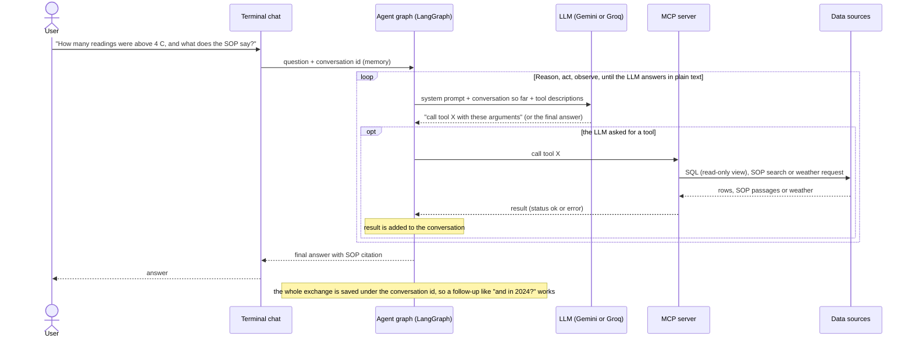
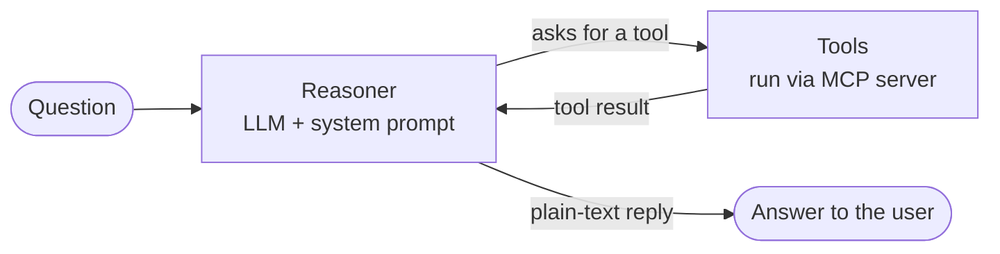

# Supply Chain FDE Project

**Ask questions about a locked-down legacy supply-chain database in plain English, and get answers grounded in the data and the company's own procedures.**

A forward-deployed-engineering (FDE) project: an AI agent that answers questions about cold-chain incidents, using the client's historical SQL Server data and its standard operating procedures (SOPs), with the database protected by a read-only identity.

## The problem

A logistics client keeps its operational history (32,065 hourly records, 26 columns: GPS position, cargo temperature, traffic congestion, delays, risk class) in a legacy **Microsoft SQL Server 2022** database. The database has **no API**, requires credentials, and the data is protected. The client's rules for handling incidents (for example, what to do when cargo goes above 4 °C) live in separate SOP documents.

So today, answering "what happened, and what should we do about it?" means a person writes SQL, reads a policy document, and joins the two in their head. A fixed dashboard doesn't help much either: it only answers the questions someone thought of in advance.

## The solution

A chat agent that does that work for the user. The user asks a question; the agent decides what it needs, fetches it, and replies with a short, cited answer.

Example questions it is built for:

- "How many readings were above 4 °C, and what does the SOP say to do about a breach?"
- "Which readings were nearest this location, and what is the weather there now?"
- "And in 2024?" (follow-ups work, because the conversation is remembered)

## How it works

```
 question ──► Agent (LangGraph, Gemini or Groq) ◄──► MCP server ──┬─ SQL tool     ──► SQL Server (read-only view)
                  │  decides which tool to use,                   ├─ SOP search   ──► Pinecone (company procedures)
                  │  loops until it can answer                    └─ Weather tool ──► Open-Meteo (live weather)
                  ▼
            cited answer
```

| Part | What it does |
| --- | --- |
| **Agent** | A LangGraph loop around an LLM: it decides which tool a question needs, calls it, reads the result and repeats until it can answer. Remembers earlier turns of the conversation. |
| **Tools (MCP server)** | Three tools with a clear contract, exposed over the Model Context Protocol: query historical data, search the SOPs, fetch live weather. The agent sees only this defined surface, never the database directly. |
| **SOP search (RAG)** | The SOP documents are split into chunks, turned into vectors with a local embedding model and stored in Pinecone. The agent searches by meaning and quotes the source. The pipeline syncs incrementally, so only changed files are re-processed. |
| **Safe database access** | The agent connects as a dedicated SQL Server login that can only `SELECT` from one view. The view translates the legacy column names into business names. Everything else is denied by the database itself. |

### What happens when a user asks a question

The agent follows the **ReAct** pattern (reason, act, observe): the LLM reasons about what it needs, asks for a tool, reads the result, and repeats until it can answer. The LLM never runs anything itself; our code runs the tool and hands back the result.



The same loop as a graph (this is the code in `src/agent/graph.py`):



Two details worth knowing:

- **One question can use several tools.** For example, the agent can look up the incident in SQL, search the SOP for the matching rule, and then answer. Each trip around the loop is one more LLM call.
- **Tool errors don't stop the agent.** A failed tool call comes back as a result the LLM can read, so it can fix its input and retry, or tell the user that a source is unavailable.

## Why it can be trusted with company data

- **Least privilege, enforced by the database.** The agent's login has `SELECT` on a single view and nothing else. Even if the agent or its prompt were manipulated, the database refuses writes and access to the raw tables.
- **Defence in depth.** On top of the permissions, queries are validated (one `SELECT` only), capped at 50 rows and given timeouts.
- **Grounded answers.** The agent is told never to invent numbers, causes or procedures, and to cite the SOP source. If the tools return nothing useful, it says so.
- **Failures are data, not crashes.** Tool errors come back to the agent as structured results it can react to.
- **Audit trail** (built in the reference implementation, see status below). Every turn can be logged by an insert-only login and read through a select-only one.

## Stack

Python · Microsoft SQL Server 2022 (Docker) · Pinecone · sentence-transformers (local embeddings) · LangGraph / LangChain · Model Context Protocol (FastMCP) · Gemini or Groq · uv · Docker

## Status and how this repo is organised

Phases 1 to 5 (data loading, SOP ingestion, agent security layer, tools, agent, audit log and Streamlit UI) were first built as a complete AI-written reference implementation. That original version is kept in git history (commit `dd9ee4a` moved it to `src_reference/`; the directory was removed once the rewrite was finished). The code in `src/` is a from-scratch rewrite, written by hand to learn each concept properly. It covers all five phases: loader, SOP ingestion, security view, tools, MCP server, agent, terminal chat, audit log and Streamlit UI (the UI was adapted from the reference implementation, the rest was written by hand). The tests are not rewritten yet. The problem framing is in [`docs/problem_statement.md`](docs/problem_statement.md).

## Phase Status

> **The code in `src/` is the hand-written rewrite.** Phases 1, 3 (3a, 3b, 3c), 4 (`src/agent/`: `llm.py`, `tools.py`, `prompts.py`, `graph.py`, `cli.py`) and 5 (audit log: `audit.py`, `turn.py`, `setup_audit_log.sql`; Streamlit UI in `src/ui/`, adapted from the original AI-written implementation) are rewritten. The original implementation was removed from the tree and is in git history (commit `dd9ee4a`). The tests are not rewritten yet: the `tests/` folder still targets the original code, so `make test` does not work.

| Phase | Status | Docs |
| --- | --- | --- |
| 1 — Local SQL Server development environment | Complete: Docker container running, CSV validated and published to `dbo.supply_chain_logistics` | [`docs/phase1-plan.md`](docs/phase1-plan.md), [`docs/phase1-notes.md`](docs/phase1-notes.md) |
| 2 — Solution exploration | Complete: business case and technical design (HLD/LLD) drafted; some LLD items (chunking strategy, SOP ingestion pipeline) deferred to Phase 3 | [`docs/research.md`](docs/research.md), [`docs/technical-design-doc.pdf`](docs/technical-design-doc.pdf), [`docs/business-pitch.html`](docs/business-pitch.html), [`docs/phase2-notes.md`](docs/phase2-notes.md) |
| 3 — Implementation | Complete: SOP ingestion (3a), read-only agent user + semantic view (3b), and the three agent tools behind an MCP server (3c) | [`docs/phase3-notes.md`](docs/phase3-notes.md), [`docs/phase-3-plan.md`](docs/phase-3-plan.md) |
| 4 — Agent orchestration | Complete: LangGraph ReAct agent (Gemini or Groq reasoner) calling the Phase 3 tools via MCP, with a terminal chat (`make agent`) | [`docs/phase4-notes.md`](docs/phase4-notes.md), [`docs/phase-4-plan.md`](docs/phase-4-plan.md) |
| 5 — Audit log and Streamlit UI | Complete: append-only audit log with insert-only and read-only logins (5a), and a single-chat Streamlit UI with live tool cards and an audit viewer (5b) | [`docs/phase5-notes.md`](docs/phase5-notes.md), [`docs/phase5-plan.md`](docs/phase5-plan.md) |

## Prerequisites

- [uv](https://docs.astral.sh/uv/) (Python dependency manager and runner)
- Docker (for the local SQL Server container)
- unixODBC + Microsoft ODBC Driver 18 or 17 for SQL Server, installed on the **host** (the ingestion script is a client that connects out to the containerized database — see [`docs/phase1-plan.md`](docs/phase1-plan.md#ingest-the-raw-dataset) for why and for install commands)

## Setup

```bash
uv sync
```

This creates `.venv` and installs the locked dependencies from `uv.lock`.

## Common Commands

| Command | Purpose |
| --- | --- |
| `make install` | Lock and sync dependencies |
| `make sqlserver-up` / `make sqlserver-down` | Start / stop the local Docker SQL Server |
| `make ingest` | Load the CSV into the local SQL Server (`dbo.supply_chain_logistics`) |
| `make sop-ingest` | Sync the SOP files in `data/policy/` to the Pinecone index (new, changed and deleted files only) |
| `make agent` | Chat with the agent in the terminal. Every turn is audited. The model is chosen by `LLM_PROVIDER` in `envs/LLM.env` (Gemini or Groq) |
| `make mcp-server` | Run the MCP server (three agent tools) over stdio |
| `make audit-db-setup` | Create the `audit_2` schema, the audit table and the two audit logins (needs `envs/audit_sqlserver.env`) |
| `make ui` | Start the Streamlit chat and audit viewer on http://localhost:8501 (light and dark themes: top-right menu, Settings, Theme) |
| `make agent-db-setup` | Create the read-only agent login `USR_FDE_RO_2` and the `ai_2.VW_SUPPLY_CHAIN_READINGS` view (needs `envs/agent_sqlserver.env`) |
| `make lint` / `make format` | Ruff lint / format |
| `make test` | Not usable yet: `tests/` still targets the original implementation and fails to collect (tests are not rewritten) |

See [`docs/phase1-plan.md`](docs/phase1-plan.md) for the full Phase 1 walkthrough, including `envs/legacy_sqlserver.env` setup.

## Project Structure

```
.
├── AGENTS.md                  # Agent/teaching guidance for this repo
├── Makefile                   # Common dev commands (wraps uv)
├── .streamlit/config.toml     # Streamlit light and dark themes
├── pyproject.toml             # Project metadata and dependencies
├── uv.lock                    # Locked dependency versions
├── data/
│   ├── README.md              # Dataset documentation
│   ├── raw/                   # Raw source CSV (gitignored)
│   └── policy/                # Sample SOP documents (RAG source)
├── envs/
│   ├── legacy_sqlserver.example.env  # Copy to legacy_sqlserver.env (gitignored)
│   ├── vectorDB.example.env          # Copy to vectorDB.env (gitignored)
│   ├── LLM.example.env               # Copy to LLM.env (gitignored)
│   ├── agent_sqlserver.example.env   # Copy to agent_sqlserver.env (gitignored)
│   └── audit_sqlserver.example.env   # Copy to audit_sqlserver.env (gitignored)
├── docs/
│   ├── problem_statement.md        # Problem framing
│   ├── phase1-plan.md              # Phase 1 scope and instructions
│   ├── phase1-notes.md             # Phase 1 retrospective: what was built, concepts
│   ├── research.md                 # Source of truth: architecture, phases, DDD, roadmap
│   ├── domain-model.md             # Canonical class/dependency diagram (current code only)
│   ├── domain-model.html           # domain-model.md, rendered
│   ├── technical-design-doc.pdf   # Phase 2 TDD draft (HLD/LLD); implemented in Phases 3 to 5
│   ├── business-pitch.html         # Phase 2 business case draft (also .pdf and a print version)
│   ├── phase2-notes.md             # Phase 2 retrospective and items deferred to Phase 3
│   ├── phase-3-plan.md             # Phase 3 design: SOP ingestion (3a), agent security layer (3b), agent tools (3c)
│   ├── phase3-notes.md             # Phase 3 retrospective: SOP ingestion, agent security layer, agent tools
│   ├── phase-4-plan.md             # Phase 4 plan: agent orchestration (implemented)
│   ├── phase4-notes.md             # Phase 4 retrospective: the orchestrator
│   ├── phase5-plan.md              # Phase 5 plan: audit log (5a) and Streamlit UI (5b)
│   └── phase5-notes.md             # Phase 5 retrospective: audit log, UI, runtime
├── src/
│   ├── data/
│   │   ├── ingest_supply_chain_dataset.py  # CSV -> SQL Server loader
│   │   ├── ingest_sop_pinecone.py          # SOP documents -> Pinecone (Phase 3a)
│   │   ├── setup_security_and_view.sql     # Read-only agent user + semantic view (Phase 3b)
│   │   └── setup_audit_log.sql             # Audit schema, table and insert-only/read-only logins (Phase 5a)
│   ├── resources/                          # Agent tools, application layer (Phase 3c)
│   │   ├── settings.py                     # Reads envs/*.env
│   │   ├── db.py                           # Shared SQL Server connection helper
│   │   ├── schema_context.py               # View description + legacy glossary for the LLM
│   │   ├── sql_tool.py                     # query_telemetry_data
│   │   ├── weather_tool.py                 # fetch_weather_conditions
│   │   ├── sop_tool.py                     # search_compliance_sop
│   │   └── mcp_server.py                   # Exposes the three tools over MCP (stdio)
│   ├── agent/                              # Orchestrator (Phase 4) and audit (Phase 5a)
│   │   ├── llm.py                          # Gemini or Groq chat model (temperature 0, one retry)
│   │   ├── prompts.py                      # System prompt
│   │   ├── tools.py                        # Persistent MCP session -> LangChain tools
│   │   ├── graph.py                        # LangGraph ReAct wiring
│   │   ├── turn.py                         # run_turn(): one audited turn as a stream of events
│   │   ├── audit.py                        # Audit writer (insert-only) and reader (select-only)
│   │   └── cli.py                          # Terminal chat (reads the events of run_turn)
│   └── ui/                                 # Streamlit UI, Phase 5b (adapted from the original implementation)
│       ├── runtime.py                      # Background agent runtime (event loop, MCP session, turn lock)
│       └── app.py                          # Chat, tool cards, sidebar, audit viewer
└── tests/                                  # Original tests, NOT rewritten: they target the old code and fail to collect
```
