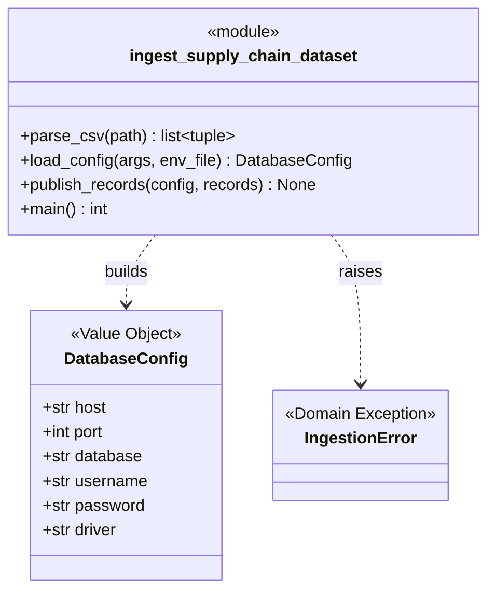
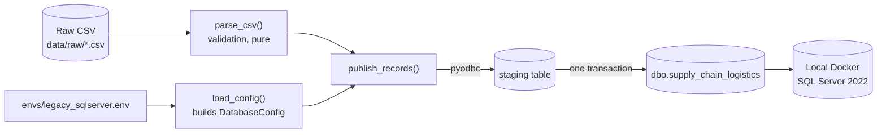
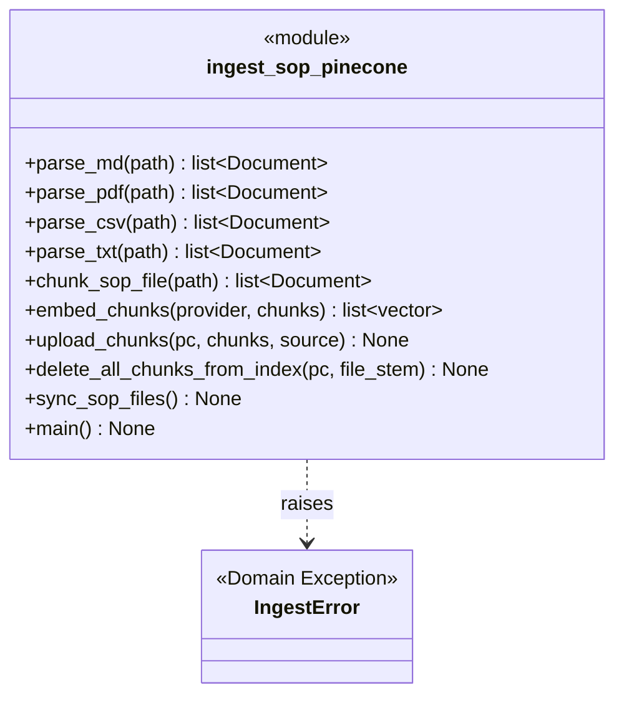
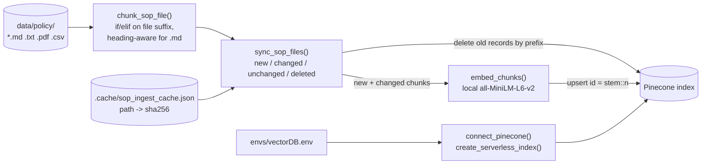
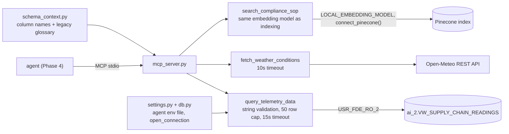
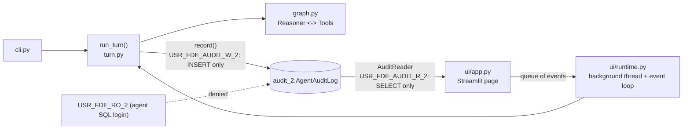
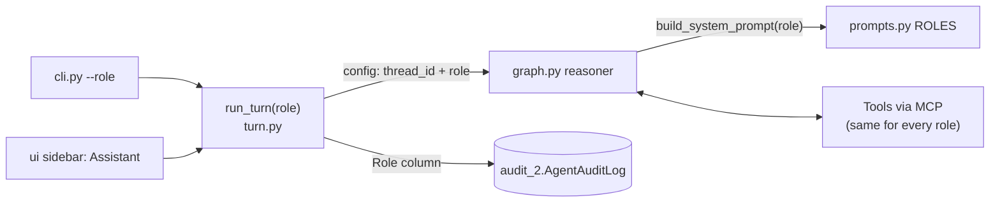

# Domain Model

Canonical class and dependency diagram for what is **actually implemented** in `src/`.
Update this file whenever a domain/package changes, and keep
[`domain-model.html`](domain-model.html) in sync with it.

## Current State

`src/data/` contains two Python modules and two SQL scripts, `src/resources/` holds the
agent's tools (Phase 3c), `src/agent/` holds the orchestrator (Phase 4a) and the audit log (Phase 5a), and
`src/ui/` holds the Streamlit UI (Phase 5b):

- `ingest_supply_chain_dataset.py` (Phase 1, complete) — raw CSV → local SQL Server.
- `ingest_sop_pinecone.py` (Phase 3a, complete) — SOP documents → Pinecone vector
  index (parsing, chunking, embedding, incremental sync).
- `setup_security_and_view.sql` (Phase 3b, complete) — read-only agent user and view.
- `src/resources/` (Phase 3c, complete) — three agent tools behind one MCP server. The
  agent orchestration that picks between them is **not built yet** — see the last
  section below.

## Phase 1: Structured Data Ingestion

### Class Diagram

### Dependency Diagram

`parse_csv()` has no dependency on the database — it can be reasoned about, and
tested, with SQL Server never running. Only `load_config()` and `publish_records()`
depend on `pyodbc` and the environment file.

### DDD Concepts Applied Here

| Concept | Where |
| --- | --- |
| Ubiquitous Language | `COLUMNS` — the business-readable field names (`iot_temperature`, `risk_classification`) used everywhere except the one translation point below |
| Anti-Corruption Layer | `LEGACY_COLUMN_NAMES` — the single place that maps ubiquitous language to the legacy system's terse column names (`IOT_TEMP_C`) |
| Entity vs. Value Object | `DatabaseConfig` is a Value Object: no identity, immutable, defined only by its field values |
| Interface as Contract | `IngestionError` is the contract for "expected, actionable failure" vs. an unexpected bug |
| Dependency direction | Validation logic (`parse_csv`) depends on nothing infrastructure-related; only the database-facing functions depend on `pyodbc` |

## Phase 3a: SOP Ingestion Pipeline

### Class Diagram

### Dependency Diagram

### DDD Concepts Applied Here

| Concept | Where |
| --- | --- |
| Interface as Contract | Every parser returns `list[Document]`, so `chunk_sop_file()` and everything downstream treat all formats the same; a new format means one new function and one new `elif` |
| Domain exception as a contract | `IngestError`, same role as Phase 1's `IngestionError`: an expected failure is reported cleanly (`main()` prints one line and exits 1) |
| Idempotent ingestion | Stable record ids (`<stem>::<n>`) and delete-by-prefix before upload mean a changed file fully replaces its old chunks and a rerun changes nothing |
| Simplified manifest (deviation from the original design) | `phase-3-plan.md` designed the new/changed/deleted sync as a SQL Server table; the implementation uses a local JSON file (`.cache/`) mapping each path to its content hash. Same logic, but per-machine state. Acceptable for a single-operator script; would need revisiting if this becomes a scheduled or multi-operator job |

## Phase 3b: Agent Security Layer (SQL)

`setup_security_and_view.sql` is a SQL script, not Python, so there are no classes to
diagram. What it creates inside `SupplyChainDb` (the rewrite uses `USR_FDE_RO_2` and the schema
`ai_2` so it sits next to the original `USR_FDE_RO` and `ai`):

| Object | Role |
| --- | --- |
| `dbo.supply_chain_logistics` | Real table with legacy column names; written only by the Phase 1 loader |
| `ai_2.VW_SUPPLY_CHAIN_READINGS` | View over that table, columns renamed to the ubiquitous-language names |
| `USR_FDE_RO_2` (login + user) | The agent's identity: `SELECT` on the view only, everything else denied |

Dependency direction: `USR_FDE_RO_2` -> `ai_2.VW_SUPPLY_CHAIN_READINGS` -> `dbo.supply_chain_logistics`.
The user has no path to the table except through the view (ownership chaining).

| Concept | Where |
| --- | --- |
| Anti-Corruption Layer | The view is the outbound counterpart of `LEGACY_COLUMN_NAMES`: the loader translates names in, the view translates them out. The mapping exists in both places and must be kept in sync |
| Least privilege | `GRANT SELECT` on one object; `DENY` on the `dbo` and `ai_2` schemas overrides any grant |
| Login vs user | The login (server level, in `master`) proves who the agent is; the user (database level) holds its permissions |
| Packages as layers | Schema `ai_2` is the agent-facing layer, `dbo` the legacy layer |

## Phase 3c: Agent Tools (`src/resources/`)

The application layer. Each tool is a plain function returning
`{"status": "ok" | "error", ...}`; `mcp_server.py` is a thin wrapper that
registers them.

| Concept | Where |
| --- | --- |
| Interface as Contract | The shared result shape: expected failures are data the agent can act on, never exceptions. `unavailable` (service down) is not yet separated from `error` |
| Defence in depth | `validate_sql()` and the row cap sit on top of the Phase 3b database permissions |
| Dependency direction | Tools depend on stores (SQL Server, Pinecone, HTTP); nothing in `src/data/` depends on tools. `sop_tool` imports the embedding model name from `data/` so query and index embeddings cannot diverge |
| Ubiquitous Language | `schema_context.py` builds the legacy-to-business glossary from `LEGACY_COLUMN_NAMES`, so the SOP's legacy names resolve to the names the agent can query |
| Packages as layers | `resources/` is the application layer between the agent and the data layer |

## Phase 4a: Agent Orchestrator (`src/agent/`)

A LangGraph ReAct agent. `graph.py` is pure wiring (the LLM and tools are arguments);
`llm.py` builds the Gemini or Groq chat model, `tools.py` describes how to start `mcp_server.py` (a `StdioTransport`)
and opens it with LangChain's `MCPAdapter`, `prompts.py` holds the system prompt, and `cli.py` is the terminal chat,
which keeps one MCP session open for the whole conversation. Server and client both use FastMCP.

| Concept | Where |
| --- | --- |
| Dependency direction | `agent/` depends on `resources/` only through MCP; `resources/` knows nothing about the agent. `graph.py` depends on no I/O: the model and the tools are arguments, so it can be tested with a scripted fake LLM (tests not yet written in the rewrite) |
| Interface as Contract | The agent sees three MCP tools and their descriptions, never the Python functions or the database |
| State as the single source of truth | The message list is the graph state; the checkpointer (`MemorySaver`, one `thread_id` per chat) gives conversation memory |
| Packages as layers | `agent/` is the orchestration layer above `resources/` (application layer) above `data/` |

## Phase 5: Audit Log (`src/agent/audit.py`, `turn.py`) and UI (`src/ui/`)

`run_turn()` runs one question through the graph (`astream`, one update per node) and yields typed
`TurnEvent`s; it also writes one audit row per event through `audit.record()`, which runs the insert in a worker
thread, redacts secrets and never raises. The CLI and the UI both consume `run_turn()`, so neither can skip the
audit. `ui/runtime.py` and `ui/app.py` were adapted from the reference implementation, not written by hand.

| Concept | Where |
| --- | --- |
| Least privilege, separation of duties | Three logins: the agent acts (read-only on data, denied on `audit`), the writer records (`INSERT` only), the reader views (`SELECT` only) |
| Fail open, but loudly | `record()` never raises: a failed write returns `False`, the turn yields one `audit_warning`, and the agent carries on |
| One code path | `run_turn()` is the only place a turn runs and is audited; `graph.py` stays free of I/O |
| Dependency direction | `ui/` depends on `agent/`; `agent/` does not know the UI exists. `resources/db.py` is shared by the SQL tool and the audit code |
| Packages as layers | `ui/` (presentation) over `agent/` (orchestration) over `resources/` (tools) over `data/` |

## Phase 6: Role-Based Assistants (`prompts.py`, `graph.py`, `turn.py`)

`prompts.py` holds a shared base prompt and a `ROLES` table (seven department assistants). The caller picks a role
(`cli.py --role`, or the UI sidebar); `run_turn()` puts it in the per-call config next to `thread_id`, and the graph's
reasoner builds the system prompt for that role. The same role is written on every audit row. The tools, the data
and the database permissions are the same for every role.

| Concept | Where |
| --- | --- |
| Configuration over code | A new assistant is a `ROLES` entry plus an SOP document |
| Roles are not permissions | Every role reads the same view with the same login; per-team access would need one view and login per role |
| State vs per-call config | The role is not saved in the graph state; the memory still holds only the conversation |

## Accepted Limits and Open Items

Known limits (see [`phase5-notes.md`](phase5-notes.md)): one user at a time, no login, a failed audit write is
lost apart from the warning, and the database owner can edit the audit table. Still open in the rewrite: tests
for `src/agent/` and `src/ui/`, and the weather and SOP tools do not return an `unavailable` status yet.
