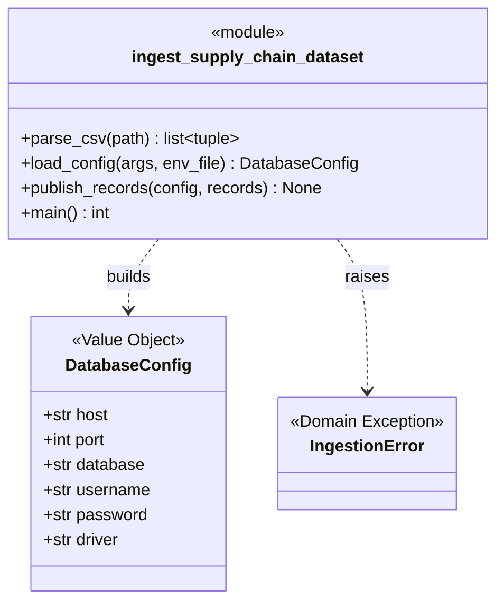
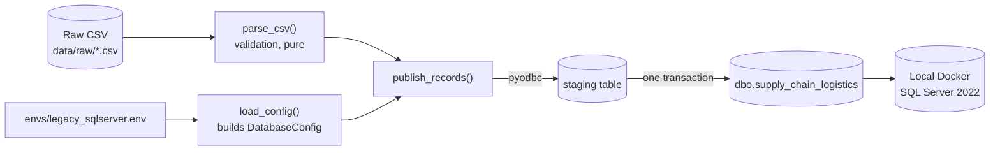
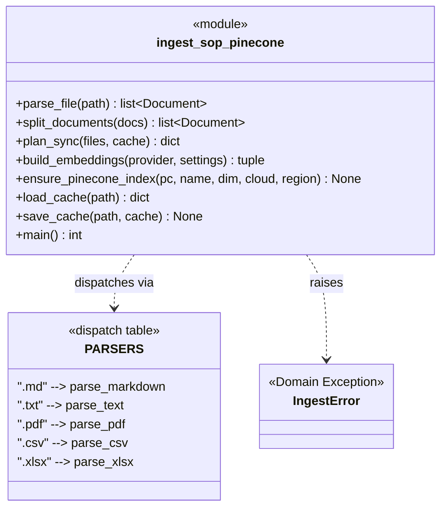
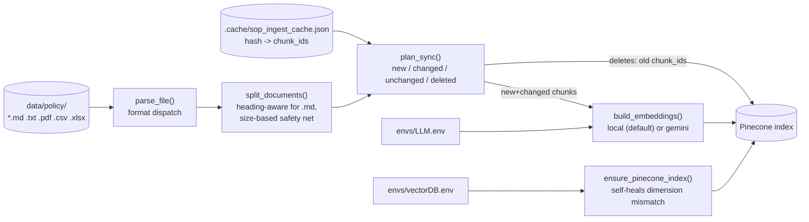
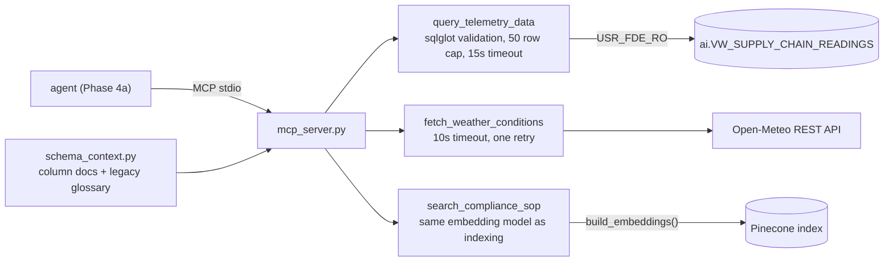
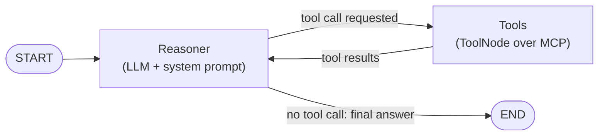
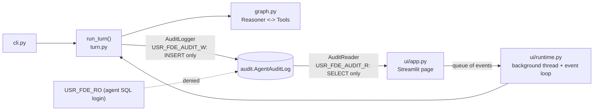

# Domain Model

Canonical class and dependency diagram for what is **actually implemented** in `src/`.
Update this file whenever a domain/package changes, and keep
[`domain-model.html`](domain-model.html) in sync with it.

## Current State

`src/data/` contains two Python modules and two SQL scripts, `src/resources/` holds the
agent's tools (Phase 3c), `src/agent/` holds the orchestrator (Phase 4a) and the audit log (Phase 5a), and
`src/ui/` holds the Streamlit UI (Phase 5b):

- `ingest_supply_chain_dataset.py` (Phase 1, complete) — raw CSV → local SQL Server.
- `ingest_sop_pinecone.py` (Phase 3a, complete) — SOP documents → Pinecone vector
  index (parsing, chunking, embedding, incremental sync).
- `setup_security_and_view.sql` (Phase 3b, complete) — read-only agent user and view.
- `src/resources/` (Phase 3c, complete) — three agent tools behind one MCP server. The
  agent orchestration that picks between them is **not built yet** — see the last
  section below.

## Phase 1: Structured Data Ingestion

### Class Diagram

### Dependency Diagram

`parse_csv()` has no dependency on the database — it can be reasoned about, and
tested, with SQL Server never running. Only `load_config()` and `publish_records()`
depend on `pyodbc` and the environment file.

### DDD Concepts Applied Here

| Concept | Where |
| --- | --- |
| Ubiquitous Language | `COLUMNS` — the business-readable field names (`iot_temperature`, `risk_classification`) used everywhere except the one translation point below |
| Anti-Corruption Layer | `LEGACY_COLUMN_NAMES` — the single place that maps ubiquitous language to the legacy system's terse column names (`IOT_TEMP_C`) |
| Entity vs. Value Object | `DatabaseConfig` is a Value Object: no identity, immutable, defined only by its field values |
| Interface as Contract | `IngestionError` is the contract for "expected, actionable failure" vs. an unexpected bug |
| Dependency direction | Validation logic (`parse_csv`) depends on nothing infrastructure-related; only the database-facing functions depend on `pyodbc` |

## Phase 3a: SOP Ingestion Pipeline

### Class Diagram

### Dependency Diagram

### DDD Concepts Applied Here

| Concept | Where |
| --- | --- |
| Interface as Contract | `PARSERS` — every entry conforms to `Callable[[Path], list[Document]]`; adding a new file format means writing one function, not touching the pipeline |
| Anti-Corruption Layer | `_base_metadata()` is the one place a raw file path becomes the canonical `source`/`file_type` vocabulary attached to every chunk, regardless of format |
| Domain exception as a contract | `IngestError`, same role as Phase 1's `IngestionError` |
| Self-healing infrastructure | `ensure_pinecone_index()` detects a dimension mismatch (e.g. from switching embedding models) and recreates the index instead of failing opaquely |
| Simplified manifest (deviation from the original design) | `phase-3-plan.md` designed the new/changed/deleted sync as a SQL Server table; the actual implementation uses a local JSON file (`.cache/`) instead — same hash-based logic, no shared/durable state. Acceptable for a single-operator script; would need revisiting if this becomes a scheduled or multi-operator job |

## Phase 3b: Agent Security Layer (SQL)

`setup_security_and_view.sql` is a SQL script, not Python, so there are no classes to
diagram. What it creates inside `SupplyChainDb`:

| Object | Role |
| --- | --- |
| `dbo.supply_chain_logistics` | Real table with legacy column names; written only by the Phase 1 loader |
| `ai.VW_SUPPLY_CHAIN_READINGS` | View over that table, columns renamed to the ubiquitous-language names |
| `USR_FDE_RO` (login + user) | The agent's identity: `SELECT` on the view only, everything else denied |

Dependency direction: `USR_FDE_RO` -> `ai.VW_SUPPLY_CHAIN_READINGS` -> `dbo.supply_chain_logistics`.
The user has no path to the table except through the view (ownership chaining).

| Concept | Where |
| --- | --- |
| Anti-Corruption Layer | The view is the outbound counterpart of `LEGACY_COLUMN_NAMES`: the loader translates names in, the view translates them out. The mapping exists in both places and must be kept in sync |
| Least privilege | `GRANT SELECT` on one object; `DENY` on `dbo` and `ai` schemas overrides any role or grant |
| Packages as layers | Schema `ai` is the agent-facing layer, `dbo` the legacy layer |

## Phase 3c: Agent Tools (`src/resources/`)

The application layer. Each tool is a plain function returning
`{"status": "ok" | "error" | "unavailable", ...}`; `mcp_server.py` is a thin wrapper that
registers them.

| Concept | Where |
| --- | --- |
| Interface as Contract | The shared `ok`/`error`/`unavailable` result shape: expected failures are data the agent can act on, never exceptions |
| Defence in depth | `validate_sql()` and the row/time caps sit on top of the Phase 3b database permissions |
| Dependency direction | Tools depend on stores (SQL Server, Pinecone, HTTP); nothing in `src/data/` depends on tools. `sop_tool` imports `build_embeddings` from `data/` so query and index embeddings cannot diverge |
| Ubiquitous Language | `schema_context.py` generates the legacy-to-business glossary from `LEGACY_COLUMN_NAMES`, so the SOP's legacy names resolve to the names the agent can query |
| Packages as layers | `resources/` is the application layer between the agent and the data layer |

## Phase 4a: Agent Orchestrator (`src/agent/`)

A LangGraph ReAct agent. `graph.py` is pure wiring (the LLM and tools are arguments);
`llm.py` builds the Gemini or Groq chat model, `tools.py` opens one persistent MCP session to `mcp_server.py`,
`prompts.py` holds the system prompt, and `cli.py` is the terminal chat.

| Concept | Where |
| --- | --- |
| Dependency direction | `agent/` depends on `resources/` only through MCP; `resources/` knows nothing about the agent. `graph.py` depends on no I/O, so it is tested with a scripted fake LLM |
| Interface as Contract | The agent sees three MCP tools and their descriptions, never the Python functions or the database |
| State as the single source of truth | The message list is the graph state; the checkpointer (`MemorySaver`, one `thread_id` per chat) gives conversation memory |
| Packages as layers | `agent/` is the orchestration layer above `resources/` (application layer) above `data/` |

## Phase 5: Audit Log (`src/agent/audit.py`, `turn.py`) and UI (`src/ui/`)

`run_turn()` runs one question through the graph and yields typed events; it also writes one audit row
per event. The CLI and the UI both consume it, so neither can skip the audit.

| Concept | Where |
| --- | --- |
| Least privilege, separation of duties | Three logins: the agent acts (read-only on data, denied on `audit`), the writer records (`INSERT` only), the reader views (`SELECT` only) |
| Fail open, but loudly | `AuditLogger` never raises: a failed write returns a message, the turn yields one `audit_warning`, and the agent carries on |
| One code path | `run_turn()` is the only place a turn runs and is audited; `graph.py` stays free of I/O |
| Dependency direction | `ui/` depends on `agent/`; `agent/` does not know the UI exists. `resources/db.py` is shared by the SQL tool and the audit code |
| Packages as layers | `ui/` (presentation) over `agent/` (orchestration) over `resources/` (tools) over `data/` |

## Planned, Not Yet Implemented

Nothing from the original design in `research.md` / `technical-design-doc.html` is left unbuilt. Known
limits (see [`phase5-notes.md`](phase5-notes.md)): one user at a time, no login, a failed audit write is lost
apart from the warning, and the database owner can edit the audit table.

Until that code exists, this section stays a pointer, not a diagram.
