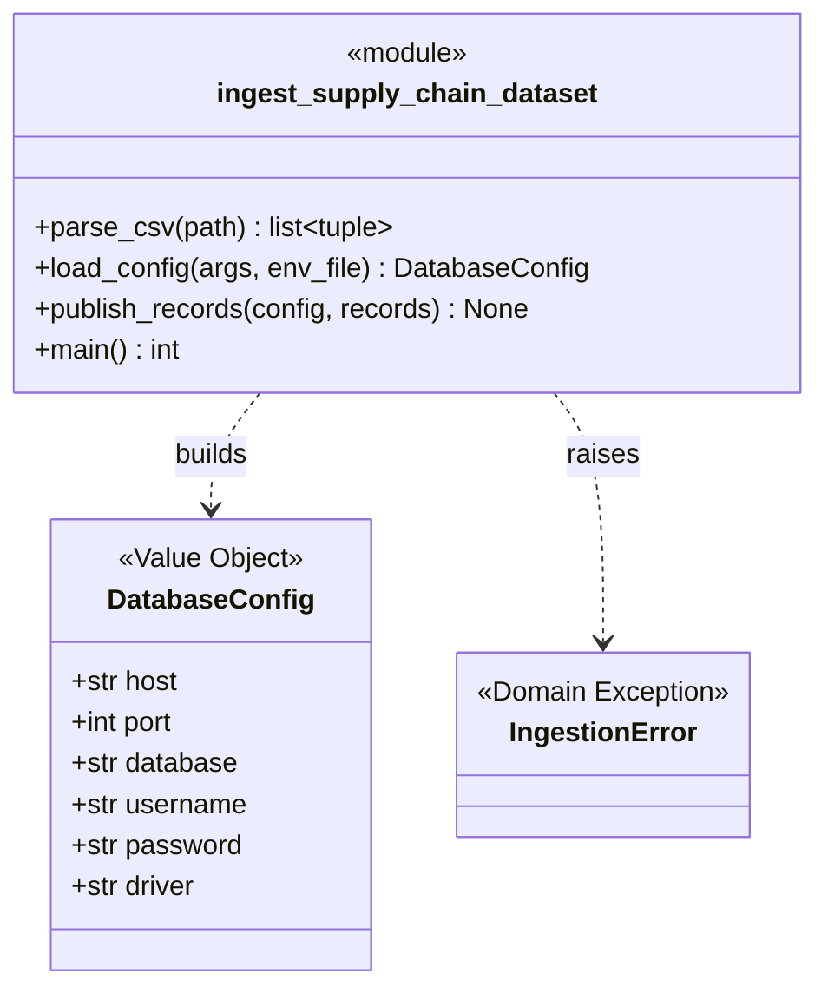
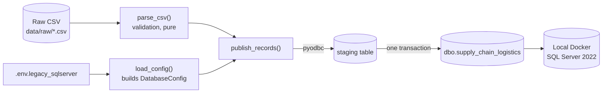

# Domain Model

Canonical class and dependency diagram for what is **actually implemented** in `src/`.
This reflects code that exists today, not the planned Phase 2 design (for that, see
[`research.md`](research.md), [`technical-design-doc.html`](technical-design-doc.html),
and [`business-pitch.html`](business-pitch.html) — none of which are implemented yet).
Update this file whenever a domain/package changes, and keep
[`domain-model.html`](domain-model.html) in sync with it.

## Current State: Phase 1 Only

The only package that exists is `src/data/`, containing a single module:
`ingest_supply_chain_dataset.py`. It has one class-shaped concept (a Value Object), one
domain exception, and a set of module-level functions that orchestrate validation and
publishing. There is no `resources/` application layer, agent, or tool interface yet —
those are Phase 2 work.

### Class Diagram

### Dependency Diagram

`parse_csv()` has no dependency on the database — it can be reasoned about, and
tested, with SQL Server never running. Only `load_config()` and `publish_records()`
depend on `pyodbc` and the environment file.

## DDD Concepts Applied Here

| Concept | Where |
| --- | --- |
| Ubiquitous Language | `COLUMNS` — the business-readable field names (`iot_temperature`, `risk_classification`) used everywhere except the one translation point below |
| Anti-Corruption Layer | `LEGACY_COLUMN_NAMES` — the single place that maps ubiquitous language to the legacy system's terse column names (`IOT_TEMP_C`) |
| Entity vs. Value Object | `DatabaseConfig` is a Value Object: no identity, immutable, defined only by its field values. There are no Entities yet — Phase 2's structured-data path will likely introduce one (e.g. a Shipment/Route concept with identity) |
| Interface as Contract | `IngestionError` is the contract for "expected, actionable failure" vs. an unexpected bug |
| Dependency direction | Validation logic (`parse_csv`) depends on nothing infrastructure-related; only the database-facing functions depend on `pyodbc` |
| Packages as layers | Not yet meaningful with a single module — see below for what Phase 2 introduces |

## Planned, Not Yet Implemented (Phase 2)

Per `AGENTS.md`'s architecture note and the drafted TDD, Phase 2 is expected to add an
**Application layer** (`resources/`) around two tool interfaces: a **text2sql** tool
(structured data path, via MCP) and a **RAG** tool (unstructured SOP path). Until that
code exists, this section is a pointer, not a diagram — the class/dependency diagrams
above will be extended once those packages are actually written.
