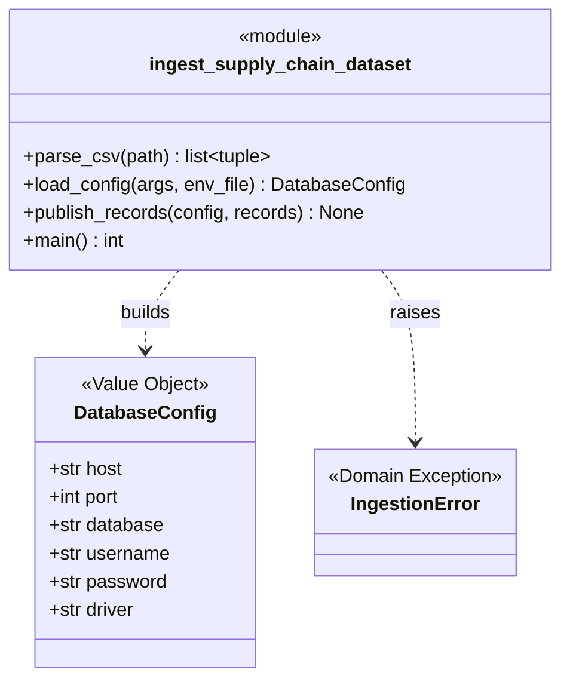
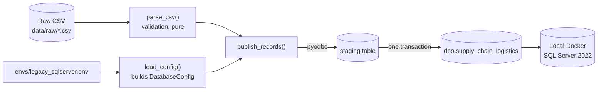
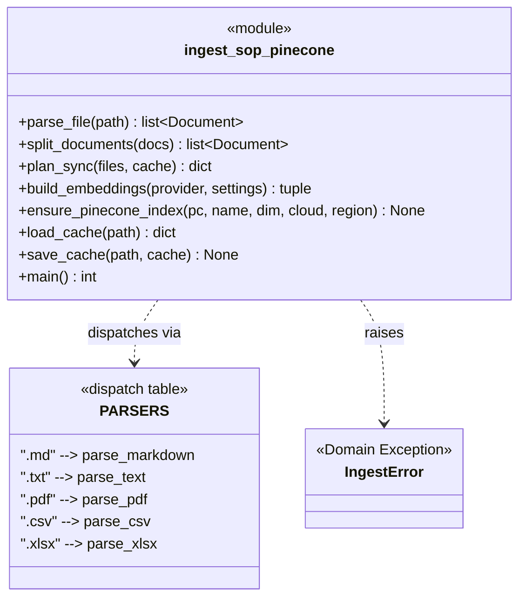
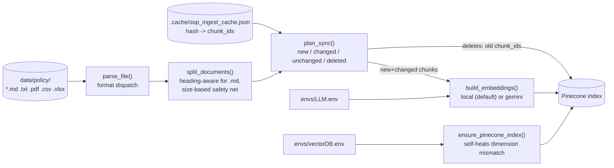

# Domain Model

Canonical class and dependency diagram for what is **actually implemented** in `src/`.
Update this file whenever a domain/package changes, and keep
[`domain-model.html`](domain-model.html) in sync with it.

## Current State

`src/data/` contains two modules:

- `ingest_supply_chain_dataset.py` (Phase 1, complete) — raw CSV → local SQL Server.
- `ingest_sop_pinecone.py` (Phase 3, in progress) — SOP documents → Pinecone vector
  index. This covers **ingestion only** (parsing, chunking, embedding, incremental
  sync). The RAG *query* tool (question → embedding → Pinecone search → result), the
  text2sql tool, the `resources/` application layer, and the agent orchestration that
  picks between them are **not built yet** — see the last section below.

## Phase 1: Structured Data Ingestion

### Class Diagram

### Dependency Diagram

`parse_csv()` has no dependency on the database — it can be reasoned about, and
tested, with SQL Server never running. Only `load_config()` and `publish_records()`
depend on `pyodbc` and the environment file.

### DDD Concepts Applied Here

| Concept | Where |
| --- | --- |
| Ubiquitous Language | `COLUMNS` — the business-readable field names (`iot_temperature`, `risk_classification`) used everywhere except the one translation point below |
| Anti-Corruption Layer | `LEGACY_COLUMN_NAMES` — the single place that maps ubiquitous language to the legacy system's terse column names (`IOT_TEMP_C`) |
| Entity vs. Value Object | `DatabaseConfig` is a Value Object: no identity, immutable, defined only by its field values |
| Interface as Contract | `IngestionError` is the contract for "expected, actionable failure" vs. an unexpected bug |
| Dependency direction | Validation logic (`parse_csv`) depends on nothing infrastructure-related; only the database-facing functions depend on `pyodbc` |

## Phase 3 (In Progress): SOP Ingestion Pipeline

### Class Diagram

### Dependency Diagram

### DDD Concepts Applied Here

| Concept | Where |
| --- | --- |
| Interface as Contract | `PARSERS` — every entry conforms to `Callable[[Path], list[Document]]`; adding a new file format means writing one function, not touching the pipeline |
| Anti-Corruption Layer | `_base_metadata()` is the one place a raw file path becomes the canonical `source`/`file_type` vocabulary attached to every chunk, regardless of format |
| Domain exception as a contract | `IngestError`, same role as Phase 1's `IngestionError` |
| Self-healing infrastructure | `ensure_pinecone_index()` detects a dimension mismatch (e.g. from switching embedding models) and recreates the index instead of failing opaquely |
| Simplified manifest (deviation from the original design) | `phase-3-plan.md` designed the new/changed/deleted sync as a SQL Server table; the actual implementation uses a local JSON file (`.cache/`) instead — same hash-based logic, no shared/durable state. Acceptable for a single-operator script; would need revisiting if this becomes a scheduled or multi-operator job |

## Planned, Not Yet Implemented

What's left to reach the design in `research.md` / `technical-design-doc.html`:

- **RAG query tool** — the other half of the unstructured path: take a user's
  question, embed it with the same model used at indexing time, search the Pinecone
  index, and return the matched chunks with their source metadata. Ingestion (this
  file's Phase 3 section above) does not include this.
- **text2sql tool** — the structured data path, via MCP, against a governed SQL Server
  view rather than the raw table.
- **Application layer (`resources/`)** — wraps both tools behind one interface the
  agent calls.
- **Agent orchestration** — the LangGraph ReAct loop that decides which tool a
  question needs.

Until that code exists, this section stays a pointer, not a diagram.
