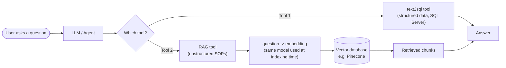
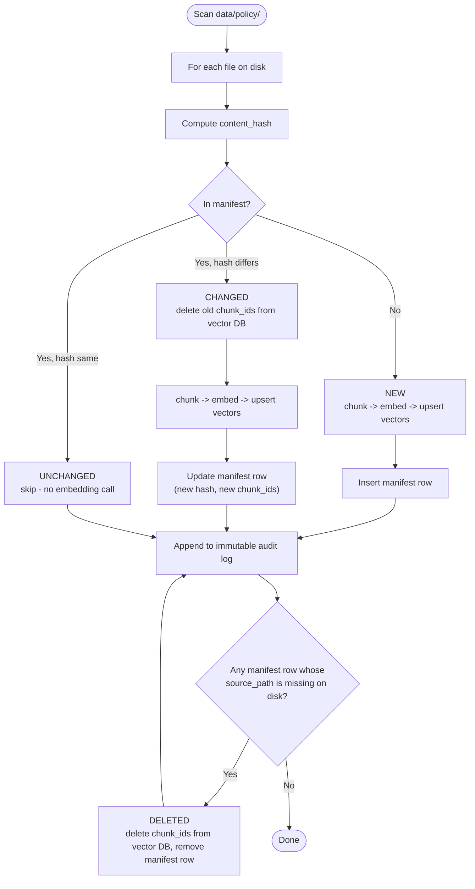

# SOP Ingestion

data/policy will contain pdf, md, txt, csv, xlsx
These files will go to chunking logic

## Chunking Logic

### MD

Markdown files will be split into chunks based on headings and paragraphs. Each chunk will retain metadata such as the source file path and heading hierarchy.

### PDF

PDF files will be split into chunks based on pages and sections. Each chunk will retain metadata such as the source file path and page number.

### TXT

Text files will be split into chunks based on paragraphs. Each chunk will retain metadata such as the source file path and paragraph index.

### CSV

CSV files will be split into chunks based on rows. Each chunk will retain metadata such as the source file path and row index.

### XLSX

Excel files will be split into chunks based on sheets and rows. Each chunk will retain metadata such as the source file path, sheet name, and row index.

### Text Splitting

Then the chunks will be passed to the text splitting which will actually break them down into smaller, semantically meaningful pieces suitable for downstream processing and indexing.

## Embedding

text chunks will be converted into embeddings using a suitable embedding model (openai or local). These embeddings will then be stored in a vector database for efficient similarity search and retrieval during downstream tasks.

### Flow



Note that index passed to vector database should be consistent with the embeddings generated from the text chunks to ensure accurate retrieval. (if openai is used as the embedding model then the same model should be used for generating embeddings for both indexing and querying)

# Re-Indexing, Versioning & Deletion Sync

Every ingestion run needs to know, for each file in `data/policy/`, whether it is new,
changed, deleted, or unchanged since the last run. Without this, a rerun either misses
real edits or re-embeds every file every time — wasteful, and an actual cost problem
once embeddings go through a paid API.

## The Manifest: Local Source of Truth for "What's Indexed Right Now"

A small table (reusing the local SQL Server already running — no new infrastructure)
tracks one row per source file:

| Column                           | Purpose                                                                                                 |
| -------------------------------- | ------------------------------------------------------------------------------------------------------- |
| `source_path`                    | e.g. `data/policy/Cold_Chain_Incident_SOP_v2.md`                                                        |
| `content_hash`                   | SHA-256 of the file's bytes — the only signal used to decide "did this change"                          |
| `chunk_ids`                      | the vector-DB IDs produced from this file, so they can be deleted precisely later                       |
| `doc_version` / `effective_date` | captured from the file's own front matter if present, for citation only — not used for change detection |
| `last_indexed_at`                | timestamp, for the audit trail                                                                          |

**Content hash, not modified-time, is the change signal.** File mtime can lie — `touch`,
a fresh `git checkout`, or clock drift can all change it without changing the content.
A hash of the bytes can't.

## Sync Flow



Every branch (new/changed/deleted) writes one entry to the same immutable audit log
already decided for the query path in Phase 2 — same concept, extended from "every
question and answer" to "every ingestion action." Unchanged files are the common case
on a rerun and cost nothing: no embedding call, no vector-DB write.

## Why This, Not Simpler Alternatives

- **Re-embedding every file on every run** — wrong on two counts: wasteful/costly, and
  it still doesn't solve deletion sync (a removed file's vectors would linger in the
  vector DB forever, answerable-but-wrong).
- **mtime-based change detection** — fragile, as above; content hash is deterministic
  regardless of filesystem metadata.
- **A file-watcher/daemon for continuous sync** — over-engineering for now. A manual,
  idempotent CLI command (`make sop-ingest`, mirroring Phase 1's `make ingest`) run on
  demand is consistent with how Phase 1 already works, and is enough until there's a
  real need for continuous sync.

# Phase 3b: Agent Security Layer (Read-Only User + Semantic View)

**Status: complete.** Implemented in `src/data/setup_security_and_view.sql`, run with
`make agent-db-setup`, and verified by the script's built-in self-check.

## Goal

Give the future text2sql tool a database identity that can read approved data and
nothing else. Security is enforced by SQL Server itself, so a bad prompt or a wrong
generated query cannot modify data, however it was produced (Phase 2 decision; see
`research.md`, Security).

## What gets created

| Object                             | Purpose                                                                                                                                       |
| ---------------------------------- | --------------------------------------------------------------------------------------------------------------------------------------------- |
| Login + user `USR_FDE_RO`          | The agent's identity. Member of `public` only, no other roles                                                                                 |
| Schema `ai` (owned by `dbo`)       | Home for agent-facing views, kept separate from the legacy `dbo` tables                                                                       |
| View `ai.VW_SUPPLY_CHAIN_READINGS` | `dbo.supply_chain_logistics` with legacy names translated to the project's ubiquitous-language names (`IOT_TEMP_C` becomes `iot_temperature`) |

```
USR_FDE_RO --SELECT--> ai.VW_SUPPLY_CHAIN_READINGS --(ownership chain)--> dbo.supply_chain_logistics
USR_FDE_RO --any other access--> denied
```

## Schemas: `dbo` vs `ai`

`dbo` and `ai` are two **schemas** (folders) inside the one database, `SupplyChainDb`,
not two databases. Think of the database as a building and schemas as floors.

| Schema | Analogy        | Holds                                                      | Used by                          |
| ------ | -------------- | ---------------------------------------------------------- | -------------------------------- |
| `dbo`  | Ground floor   | The real data: `supply_chain_logistics`, the staging table | The legacy system and our loader |
| `ai`   | Reception desk | Only **views** (saved `SELECT` queries that store no data) | The agent                        |

Why separate them:

1. **Clear boundary.** Anything in `ai` is meant for the agent; anything in `dbo` is not.
2. **Safe growth.** A table added to `dbo` later is never visible to the agent by
   accident. Only something deliberately placed in `ai` and explicitly granted is.
3. **Translation.** The view renames terse legacy columns (`IOT_TEMP_C` becomes
   `iot_temperature`), so the agent never sees the legacy names.

## What `USR_FDE_RO` can do

| Action                                          | Allowed?                      |
| ----------------------------------------------- | ----------------------------- |
| `SELECT` from `ai.VW_SUPPLY_CHAIN_READINGS`     | Yes, the only thing it can do |
| `SELECT` from `dbo.supply_chain_logistics`      | No                            |
| Insert, update or delete, even through the view | No                            |
| Drop or create tables, views or schemas         | No                            |

The view can read the table even though the user cannot, because SQL Server lets the
view's owner (`dbo`) read the table on the user's behalf. Like a bank teller who shows
you your balance without handing you the vault key.

## How it works

- **Ownership chaining.** The view and the table share an owner (`dbo`), so SQL Server
  does not check the user's permissions on the table when the view is read. The user
  needs `SELECT` on the view only.
- **Grant narrow, deny broad.** `GRANT SELECT` is on the single view, not the schema, so
  a view added later is not exposed by accident. `DENY` on `dbo` (select, write,
  execute, alter, view definition) and on `ai` (write, alter), plus `DENY CREATE ...`,
  overrides any role or grant. `DENY` does not break the view, because chained access
  skips the check.
- **The view is the second Anti-Corruption Layer.** The Python loader's
  `LEGACY_COLUMN_NAMES` translates names going in; the view translates them coming out.
  The mapping now lives in two places (Python and SQL) and must be kept in sync.
- **Secrets stay out of the script.** The password arrives as a `sqlcmd` variable from
  `envs/agent_sqlserver.env` (gitignored; template in `agent_sqlserver.example.env`).
  The script is idempotent and re-running it rotates the password.
- **Self-check built in.** The script ends by impersonating the agent (`EXECUTE AS USER`)
  and asserts: view `SELECT` works; raw-table `SELECT`, `DELETE`/`UPDATE` through the
  view, `DROP TABLE` and `CREATE TABLE` are all refused. Any failure aborts with an error.

## Run

```bash
cp envs/agent_sqlserver.example.env envs/agent_sqlserver.env   # set a strong password, no single quotes
make sqlserver-up && make ingest                               # table must exist first
make agent-db-setup
```

Expected output ends with six `PASS` lines and `All security checks passed.`

`sqlcmd` runs inside the container (`docker exec`), so no host SQL client is needed.

## Known limits (deliberately not solved here)

- **Design drift.** `research.md` and the TDD name the view `VW_ACTIVE_FLEET` with
  `Shipment_ID`, `Cargo_Type`, `Current_Temperature`. The dataset has no shipment id or
  cargo type and holds hourly historical readings, so that view cannot exist. The
  implemented view is `VW_SUPPLY_CHAIN_READINGS`; `research.md` has been updated to match.
- **`SELECT`-only does not stop expensive queries.** A `SELECT *` or a cross join can
  still be slow. Row caps and query timeouts belong in the text2sql tool (next step).
- **No audit log yet.** `AgentAuditLog` from the TDD is not part of this phase.
- **Dev-only secret handling.** The password is visible in the process list while
  `docker exec` runs. Acceptable locally; a client deployment would use a secret store.
- **Local only.** Like Phase 1, this targets the local Docker instance, not the
  client's server.

# Phase 3c: Tools for the AI Agent

**Status: complete.** Implemented in `src/resources/`; 45 unit tests and 2 live integration
tests pass, and all three tools were called through the MCP server over stdio.

## Goal

Build the three tools the agent will call, as plain, testable Python functions, and expose
them through one MCP server. No agent, LLM or UI yet: that is Phase 3d. When 3c is done,
every tool can be called and tested by hand with the agent absent.

| Tool | Path | Backend |
| --- | --- | --- |
| `query_telemetry_data` | Structured (text2sql) | `ai.VW_SUPPLY_CHAIN_READINGS` on SQL Server, as `USR_FDE_RO` |
| `fetch_weather_conditions` | Live REST | Open-Meteo forecast API (free tier, no key) |
| `search_compliance_sop` | Unstructured (RAG) | SOP chunks in the Pinecone index built in 3a |

## Decisions made

| Question | Decision | Why |
| --- | --- | --- |
| Where does the code live? | `src/resources/`: the application layer named in the Phase 2 design | Keeps agent-facing code apart from `src/data/` (ingestion scripts). Tools depend on data stores; nothing in `src/data/` depends on them |
| MCP or plain functions? | Both, in layers. Logic is plain functions in `src/resources/`; one thin MCP server wraps them | Phase 2 chose MCP. Plain functions are unit-testable without a server. If MCP changes, only the wrapper changes |
| Does the agent pass SQL or parameters? | The agent writes a SQL string; the tool validates and runs it | Matches the Phase 2 text2sql design. The view has no "sensor type" column, so fixed parameters could not cover the questions anyway |
| Weather: point or route? | A single point (`latitude`, `longitude`) | The API takes a point. The agent can call it for each place it cares about. A route tool can come later |
| "Congestion index"? | Dropped | Open-Meteo has no traffic or congestion data, so such an index would be invented. The tool returns raw weather values plus a labelled, derived `weather_disruption_level` |
| HTTP client | `httpx` | Established, with timeouts built in |
| SQL validation | `sqlglot` (T-SQL dialect) | A real parser beats regexes for "exactly one SELECT" |
| MCP library | `mcp` (official Python SDK) | Standard way to expose tools. Installed version is 2.x, where `FastMCP` is renamed `MCPServer` (`mcp.server.mcpserver`) |

## Layout

```
src/
├── data/                       # existing ingestion scripts (3a, 3b)
└── resources/
    ├── __init__.py
    ├── settings.py             # reads envs/*.env once; no credentials in code
    ├── sql_tool.py             # query_telemetry_data
    ├── weather_tool.py         # fetch_weather_conditions
    ├── sop_tool.py             # search_compliance_sop
    ├── schema_context.py       # view description handed to the LLM
    └── mcp_server.py           # thin wrapper: registers the three functions
tests/
├── test_sql_tool.py
├── test_weather_tool.py
└── test_sop_tool.py
```

Because `src/data/` holds scripts run by path, `src/resources/` is run as a module. Add
`pythonpath = ["src"]` to the pytest config and `PYTHONPATH=src` to the Makefile targets.
Add `src/data/__init__.py` so `sop_tool.py` can import `build_embeddings` (see tool 3).

## Shared tool contract

Every tool returns a dict and **never raises to the agent**. Expected failures become
data the agent can read and react to.

```
{"status": "ok" | "error" | "unavailable", ...payload..., "error": "<message>"}
```

- `ok`: the payload is present.
- `error`: the input was wrong (bad SQL, bad coordinates). The message says how to fix it,
  so the agent can retry. This is the Phase 2 self-correction loop.
- `unavailable`: the backend failed (timeout, network). The agent must say the data is
  missing and must not guess (HLD, Resiliency).

Error text must never include credentials. Reuse the redaction approach from Phase 1.

## Tool 1: `query_telemetry_data(sql: str)`

Runs one agent-written SQL query against `ai.VW_SUPPLY_CHAIN_READINGS`.

**Safeguards (defence in depth; the database permission model from 3b is the real wall):**

1. Connect as `USR_FDE_RO`, using `envs/agent_sqlserver.env`. Never use `sa`.
2. Parse with `sqlglot`. Accept exactly one statement that is a plain `SELECT`. Reject
   multiple statements, `SELECT ... INTO`, and anything else, with a clear message.
3. Row cap: fetch at most `MAX_ROWS` (start at 200) and return `"truncated": true` if more
   existed, so the agent knows to aggregate instead of listing.
4. Timeout: a query timeout of 15 seconds; on expiry return `unavailable`.
5. Return the executed SQL together with the results, so the agent can reason about its own
   query across turns.

**Output:** `{"status", "sql", "columns", "rows", "row_count", "truncated"}`.

**Context for the LLM (`schema_context.py`):** the agent cannot write good SQL blind. Provide
the view name, each column with its unit and meaning (from `data/README.md`), the data range
(2021-01-01 to 2024-08-29 hourly, latitude 30 to 50, longitude -120 to -70), and the T-SQL
dialect reminder (`TOP`, not `LIMIT`).

**SOP vocabulary mismatch:** the sample SOP quotes legacy names (`IOT_TEMP_C`,
`PORT_CONG_LVL`, `RISK_CLASS`, `DELAY_PROB`), but the agent can only query the translated
names. Fix this once: add a legacy-to-business glossary to `schema_context.py`, generated
from `LEGACY_COLUMN_NAMES` so it cannot drift. The SOP files themselves stay unchanged.

## Tool 2: `fetch_weather_conditions(latitude: float, longitude: float)`

Calls Open-Meteo with `current=temperature_2m,wind_speed_10m,precipitation,weather_code`.
(The earlier draft's `hourly=temperature_2m` returns a forecast with no wind speed.)

- Validate `-90 <= latitude <= 90` and `-180 <= longitude <= 180`; otherwise `error`.
- `httpx` timeout 10 seconds, one retry. On failure return `unavailable` and never a guess.
- Output: `{"status", "latitude", "longitude", "observed_at", "temperature_c",
  "wind_speed_kmh", "precipitation_mm", "weather_code", "weather_disruption_level",
  "source"}`.
- `weather_disruption_level` (`low`, `moderate`, `high`) is a labelled heuristic from simple
  documented thresholds on wind, precipitation and weather code. The thresholds live in a
  named constant, and the tool description tells the agent it is a derived estimate.
- It is current conditions only. It cannot be compared with a historical reading's timestamp.
  The tool description must say so.

**Constraints accepted for now:** the free tier is used. Vehicle coordinates go to a third
party. Both are acceptable for development. Revisit before any client deployment.

## Tool 3: `search_compliance_sop(query: str, top_k: int = 4)`

Semantic search over the SOP index from 3a.

- Embed the query with the **same provider and model used at indexing time**: call
  `build_embeddings(provider, settings)` from `src/data/ingest_sop_pinecone.py` with the same
  `EMBEDDING_PROVIDER`. A different model means meaningless similarity scores.
- Query Pinecone through `PineconeVectorStore` using `envs/vectorDB.env`.
- Output: `{"status", "query", "results": [{"text", "source", "headings", "score"}]}`, where
  `headings` joins `Header 1/2/3`. The agent must cite `source` and the heading in its answer.
- An empty index or zero matches returns `ok` with an empty list. The agent must say no
  procedure was found and not invent one.
- A missing index or a dimension mismatch returns `unavailable` with a hint to run
  `make sop-ingest`.
- Cache caveat from 3a still applies: changing chunking without clearing the cache and the
  index leaves stale vectors.

## MCP server

`mcp_server.py` registers the three functions with `MCPServer`. Tool descriptions are part of
the contract: they tell the LLM when to use each tool, what the inputs mean, and each tool's
limits. Run over stdio for local development.

## Run

```bash
uv sync                          # includes httpx, sqlglot, mcp
make agent-db-setup              # 3b, once
make sop-ingest                  # 3a, once
make test                        # 45 offline unit tests
uv run pytest -m integration    # live SQL Server + Pinecone tests
make mcp-server                  # starts the MCP server over stdio
```

## Problems found while building

- **Connection pooling bug.** `pyodbc` pools connections by default. A query that returned a
  capped result left unread rows on its connection, and the pool handed that connection to the
  next query, which failed with "Connection is busy with results". Fixed with
  `pyodbc.pooling = False`; a live test now runs a query right after a truncated one.
- **Raw ODBC errors were unreadable** for an LLM. Messages are reduced to the server's own
  text, e.g. `Invalid column name 'bogus'. (207)`.
- **`mcp` 2.x** renamed `FastMCP` to `MCPServer`. The f-string tool description is passed as
  `description=` because an f-string cannot be a docstring.

## Test plan

| Tool | Cases |
| --- | --- |
| `query_telemetry_data` | Valid `SELECT` returns rows. `DELETE`, `DROP`, two statements and `SELECT INTO` return `error`. A raw-table query returns `error` from the database. More than `MAX_ROWS` sets `truncated`. A slow query times out as `unavailable` |
| `fetch_weather_conditions` | Out-of-range coordinates return `error`. A mocked success parses all fields. A mocked timeout and a mocked 500 return `unavailable` |
| `search_compliance_sop` | A known SOP question ("temperature breach threshold") returns the cold-chain section first. An unrelated question returns low scores. A missing index returns `unavailable` |

The SQL and SOP tests need the Docker SQL Server and Pinecone. Mark them as integration tests
so unit tests run offline. Weather tests mock HTTP, with one optional live smoke test.

## Known limits (deliberately not solved here)

- **No audit log.** `AgentAuditLog` from the TDD is not part of 3c. It belongs with the agent
  in 3d, where a decision cycle exists to log.
- **No MCP authentication.** Stdio only, local development only.
- **Heuristic weather level.** A derived estimate, not an operational measure.
- **Single SOP file.** Retrieval quality on a real SOP library is untested.
- **Dev-only secrets.** Same as 3b: environment files, not a secret store.
