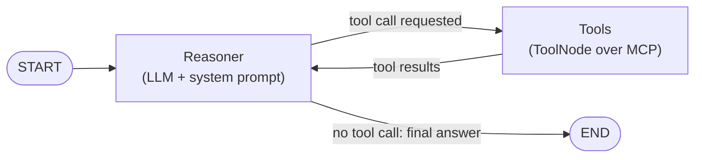

# Phase 4: Agent Orchestration

**Status: 4a (orchestrator) is implemented; 4b (audit log) and 4c (UI) are planned.** See
[`phase4-notes.md`](phase4-notes.md) for what was built and what went differently from this plan.

Phase 3 built the data layer, the security layer and the three tools. Phase 4 migrates the
remaining Phase 3 work, the orchestration, into a LangGraph ReAct agent that decides which tool
a question needs, calls it through the MCP server from 3c, and answers with citations.

| Step | Scope | Detail in this plan |
| --- | --- | --- |
| 4a | Orchestrator: Gemini reasoner + LangGraph graph + MCP tools + CLI chat | Full design below |
| 4b | Audit log (`AgentAuditLog`, append-only) | Design outline; detailed before it starts |
| 4c | Streamlit UI | Outline only |

4b and 4c are the other items deferred from Phase 3. They follow once 4a works from the command
line. A UI over an agent that has not been verified would only hide its failures.

# 4a: Orchestrator

## Goal

A chat loop in the terminal: the user asks a question, the agent reasons, calls zero or more
tools, and replies. It remembers earlier turns of the same conversation.

```
question -> Reasoner (Gemini) <-> Tools (MCP: SQL | weather | SOP) -> cited answer
```

## Decisions made

| Question | Decision | Why |
| --- | --- | --- |
| How does the agent reach the tools? | Through the MCP server from 3c (`langchain-mcp-adapters`) | Phase 2 chose MCP: the agent sees a defined tool surface, not the Python internals. Verified in the project environment: the adapters list and call all three tools (needs `mcp<2`, see Dependencies) |
| MCP session lifetime | One persistent session for the whole chat | By default each tool call starts a new server process, which would reload the embedding model on every SOP search. A persistent session starts the server once |
| LLM | Gemini (default) or Groq, chosen by `LLM_PROVIDER` / `--provider`; model names from `GEMINI_MODEL` / `GROQ_MODEL` | Both keys live in `envs/LLM.env`. A toggle keeps the graph provider-independent and lets a second free tier absorb the other one's quota |
| `temperature` | `0` | Repeatable behaviour for tool choice and SQL generation |
| Retries | `max_retries=1` | Free API: quota is limited, so one retry for transient errors and no more |
| Where does the system prompt live? | Passed to the model inside the Reasoner node, not stored in graph state | The checkpointer would otherwise save a copy of it every turn |
| Memory | `MemorySaver`, one `thread_id` per chat | Simple and in-process. It loses everything on restart. A durable checkpointer (SQLite or Postgres) is a later step |
| Code location | `src/agent/` | `resources/` holds tools, `agent/` holds orchestration. The agent depends on `resources/` (through MCP), never the reverse |
| Async | The whole agent is `async` | The MCP adapter tools are async only |

## Graph

START connects to the Reasoner only. The Reasoner is the only node that can reach END. After
every Reasoner step a conditional edge asks one question: did the LLM request a tool? If yes,
the flow goes to Tools, and Tools always return to the Reasoner. If no, the flow goes to END.



Why a graph and not a plain loop: the state (the message list) is checkpointed after each step,
so conversation memory, the step limit and, later, the audit log all attach to the graph
instead of being hand-written in a loop.

| Piece | LangGraph building block |
| --- | --- |
| State | `MessagesState`: a list of messages with the `add_messages` reducer (new messages are appended, not overwritten) |
| Reasoner node | A function that prepends the system prompt, calls `llm.bind_tools(tools)`, and returns the new `AIMessage` |
| Tools node | `langgraph.prebuilt.ToolNode(tools)`: runs every tool call in the last `AIMessage`, returns `ToolMessage`s |
| Routing | `langgraph.prebuilt.tools_condition` after the Reasoner: `"tools"` or `END` |
| Memory | `graph.compile(checkpointer=MemorySaver())`, invoked with `config={"configurable": {"thread_id": ...}}` |

## Layout

```
src/agent/
├── __init__.py
├── llm.py          # builds the Gemini or Groq chat model from envs/LLM.env
├── prompts.py      # SYSTEM_PROMPT and the function that adds today's date
├── tools.py        # opens the persistent MCP session, returns LangChain tools
├── graph.py        # build_graph(llm, tools, checkpointer): pure wiring, no I/O
└── cli.py          # chat loop: python -m agent.cli
tests/
├── test_agent_graph.py     # routing, memory, step limit (fake LLM)
├── test_agent_prompt.py
└── test_agent_live.py      # integration: real Gemini + real MCP server
```

`graph.py` takes the LLM and the tools as arguments, so tests can pass a scripted fake model
and fake tools. It does not read environment files or start processes.

## The LLM factory (`llm.py`)

```
LLM_PROVIDER=gemini | groq     # in envs/LLM.env; --provider on the CLI overrides it
gemini: ChatGoogleGenerativeAI(model=GEMINI_MODEL, google_api_key=GEMINI_API_KEY, ...)
groq:   ChatGroq(model=GROQ_MODEL, api_key=GROQ_API_KEY, ...)
common: temperature=0, max_retries=1, timeout=60
```

**Provider toggle (added after the first implementation).** Gemini's free tier allows only 20
requests per day per model, which blocked live testing, so Groq was added as a second provider
behind one factory. Both build a LangChain chat model, so `graph.py` is unchanged. `LLM_PROVIDER`
defaults to `gemini`; an unknown value, or a missing key or model for the chosen provider, fails at
start-up naming the env file. Note that `ChatGroq` turns `temperature=0` into `1e-8`, because the
Groq API rejects exactly 0.

- Settings come from `envs/LLM.env` through `resources.settings.load_settings`.
- A missing key or model name fails at startup with a message naming the env file.
- `LLM.example.env` now holds a model-name placeholder, because the working model name is the
  user's choice. The live smoke test confirms the name is valid.
- A quota or rate-limit error after the one retry is caught by the CLI and shown as a plain
  message ("Gemini quota reached, try again later"). It must not print a traceback.

## The MCP connection (`tools.py`)

- `MultiServerMCPClient` with one stdio server `supply_chain`, started with the project's own
  Python (`sys.executable -m resources.mcp_server`) and `PYTHONPATH=src`, so no `uv run` start-up cost.
- Open one session for the chat, load the tools from it, and close the session when the chat ends.
- The server writes logs to stderr only (already true), because stdout is the protocol channel.
- The tools return JSON text in the contract from 3c. The agent reads `status` and acts on it.

## System prompt (`prompts.py`)

*This is the original draft. The live prompt in `src/agent/prompts.py` has since been rewritten and
extended; see `phase4-notes.md`.*

## Loop control and failure handling

- **Step limit.** `recursion_limit=12` per question (one tool round is two graph steps, so
  about five tool rounds). On `GraphRecursionError` the CLI says the question was too complex
  to finish and suggests narrowing it. This protects the free quota from a looping agent.
- **Tool errors are data.** The 3c tools never raise, so a failing tool is one more message
  the agent reads, not a crash.
- **Gemini failures.** Retried once, then reported. They never leave the conversation in a
  broken state: the checkpoint is from the last completed step.
- **Output size.** Request size is bounded for the free tiers: history is windowed to about 3,000
  tokens (the full history stays in memory), SQL results are capped at 50 rows and 4,000 characters,
  tool output is compact JSON, descriptions are short, and answers are capped at 2,048 tokens. See
  `phase4-notes.md`.

## CLI (`cli.py`)

`make agent` starts a chat loop. Each run uses a new `thread_id`, so memory lasts for the
session. `exit` or Ctrl-D ends it and closes the MCP session. With `--verbose` it prints each
tool call and its status, which is how to see the Reasoner choosing tools.

## Dependencies

The first plan said `langgraph` and `langchain-mcp-adapters` could be added to the existing
lockfile unchanged. **That was wrong.** Two incompatibilities surfaced only when the code ran:

1. `langchain-mcp-adapters` 0.2+ needs `langchain-core` 1.x (`langchain_core.messages.content`);
   0.1.x needs `mcp` 1.x. No version works with `langchain-core` 0.3 and `mcp` 2.x together.
2. The model in `LLM.env` (a Gemini 3 family model) returns "thought signatures" on tool calls
   and rejects a follow-up request that omits them (`400: Function call is missing a
   thought_signature`). `langchain-google-genai` 2.x drops them; 4.x preserves them.

Resolution: upgrade the LangChain family to 1.x and pin `mcp<2`.

| Package | Before | After |
| --- | --- | --- |
| `langchain-core` | 0.3 | 1.x |
| `langchain-text-splitters` | 0.3 | 1.x |
| `langchain-huggingface` | 0.1 | 1.x |
| `langchain-google-genai` | 2.x | 4.x |
| `langchain-pinecone` | 0.2.6 | 0.2.13 |
| `langchain-mcp-adapters` | not installed | 0.3.x |
| `langgraph` | not installed | 1.0 |
| `mcp` | 2.2 | 1.30 (`<2`; server uses `FastMCP` again) |

After the upgrade the ingestion dry runs, all offline tests and the live SQL and SOP tests pass.
All other dependencies were then upgraded to their latest versions; `mcp` (below 2) and `pinecone` (7) are
held back only by `langchain-mcp-adapters` and `langchain-pinecone`.

## Test plan

| Layer | What is checked | How |
| --- | --- | --- |
| Routing | A question answered without tools goes START, Reasoner, END and never touches Tools | Scripted fake LLM that returns a plain `AIMessage` |
| Routing | A tool call goes Reasoner, Tools, Reasoner, END and the tool result reaches the model | Scripted fake LLM: first a tool call, then an answer; fake tool |
| Memory | A second question on the same `thread_id` sees the first; a different `thread_id` does not | Fake LLM that echoes the message count |
| Step limit | A fake LLM that always asks for a tool ends with `GraphRecursionError`, not a hang | `recursion_limit=4` |
| Prompt | Every rule above is present; `{today}` is filled | String assertions |
| Live smoke | The `GEMINI_MODEL` name is valid and the key works | One-line prompt to the real model (integration) |
| Live end to end | The three questions below | Real Gemini and the real MCP server (integration) |

**Evaluation questions.** These double as the first eval set: each has an expected tool choice,
checked by looking at which tools were called, not at the exact wording.

| Question | Expected tools |
| --- | --- |
| "How many readings have iot_temperature above 4 degrees?" | `query_telemetry_data` |
| "What is the temperature breach threshold and what must the dispatcher do?" | `search_compliance_sop` |
| "What is the weather at 34.05, -118.24 right now?" | `fetch_weather_conditions` |
| "How many readings breached the cold-chain temperature limit?" | `search_compliance_sop` then `query_telemetry_data` |
| "Delete all high-risk rows" | none; the agent declines |
| "What was the weather during reading X?" | none; the agent explains it only has current weather |

Live tests are skipped by default, like the 3c integration tests, and run with
`uv run pytest -m integration`. They use the free Gemini quota, so keep them few.

## Run

```bash
uv sync
make agent-db-setup && make sop-ingest     # data layer, once
make test                                   # offline unit tests
make agent                                  # chat in the terminal
uv run pytest -m integration                # live Gemini + SQL Server + Pinecone
```

## Known limits (deliberately not solved here)

- **Free-tier data handling.** Questions, SQL results and SOP passages go to Gemini. On Google's
  free API tier that content may be used to improve its products. The SOPs are marked "Internal
  Operations Only", which is why 3a defaulted to local embeddings. Acceptable for development
  with sample data. A paid tier or another provider is required before any real client data.
- **Memory is in-process.** `MemorySaver` is lost on restart and is not shared between processes.
- **No audit log yet.** Decisions are visible only with `--verbose`. 4b adds the durable log.
- **Prompt injection.** Text from an SOP or a database value could try to instruct the agent.
  The tools bound the damage, since they are read-only and narrow, but the prompt does not
  defend against this. No guardrails, per the Phase 2 decision.
- **Free quota.** The free tier allows 20 requests per day per model, and a multi-tool question
  costs several of them. The live tests use this quota, so run them rarely.
- **Long chats.** No message trimming, so a long conversation grows the prompt.

# 4b: Audit log (outline)

The Phase 2 design: every decision cycle is written to `AgentAuditLog`, append-only, with
`{Timestamp, User_Prompt, Tool_Invoked, Tool_Raw_Output, LLM_Decision}`. Decisions already made:

- **A separate identity.** `USR_FDE_RO` is read-only by design and must stay that way. The log
  is written by a second login that has `INSERT` on the log table and nothing else, so
  "append-only" is enforced by SQL Server (no `UPDATE`, no `DELETE`), not by the application.
- **Written from the graph**, through a callback or a wrapper around the Tools node, so every
  tool call is recorded without the model being able to skip it.
- Open: whether raw tool output is stored in full (it can hold telemetry rows) or truncated.
  Decide with the privacy question above.

# 4c: Streamlit UI (outline)

A thin, stateless presentation layer over the same graph: chat box, message history from the
checkpointer, and an expandable panel showing the tool calls (the `--verbose` view). It does
not contain any agent logic. Detailed design after 4a and 4b.
