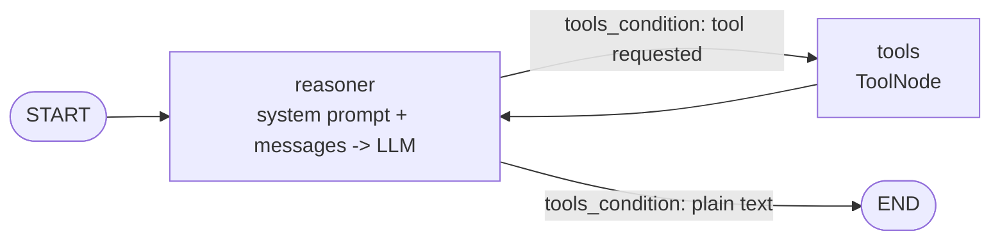

# Phase 4 Notes: Agent Orchestration (hand-written rewrite)

**Status: Phase 4 is complete in the rewrite.** The orchestrator was written by hand in `src/agent/`. The
original AI-written version is in git history (commit `dd9ee4a` moved it to `src_reference/agent/`, later removed). See [`phase-4-plan.md`](phase-4-plan.md) for the original design. This file
describes the rewrite, and says where it differs from that plan.

## What We Built

A LangGraph ReAct agent: an LLM (Gemini by default, or Groq) reasons about each question, calls the Phase 3 tools
through the MCP server when it needs data, and answers in a terminal chat that remembers the conversation.

```
question -> Reasoner (Gemini or Groq) <-> Tools (MCP: SQL | weather | SOP) -> cited answer
```

## File Structure

```
src/
├── data/                  # Phase 1, 3a, 3b
├── resources/             # Phase 3c: the three tools and the MCP server (FastMCP)
│   └── mcp_server.py
└── agent/                 # Phase 4
    ├── __init__.py
    ├── llm.py             # build_llm(provider): Gemini or Groq from LLM.env, temperature 0, max_retries 1
    ├── prompts.py         # SYSTEM_PROMPT + build_system_prompt(today)
    ├── tools.py           # StdioTransport + open_adapter(): MCP server -> LangChain tools
    ├── graph.py           # build_graph(llm, tools): pure wiring, no I/O
    └── cli.py             # python -m agent.cli
```

There are no tests for `src/agent/` yet. `tests/` still targets the original code.

## How an agent works

An LLM never runs anything. It returns a message that says "call this tool with these arguments". The code runs
the tool, appends the result to the conversation and calls the LLM again. When the LLM replies with plain text
instead of a tool request, that text is the answer. This is the ReAct pattern (reason, act, observe).



## Topic Sections

### The graph (`graph.py`)

`build_graph(llm, tools)` takes the model and the tools as arguments and returns a compiled graph. It knows nothing
about Gemini, Groq or MCP, which keeps it free of I/O and easy to test with a fake model.

- **State** is `MessagesState`: a dictionary with one key, `"messages"`, a list that new messages are appended to.
  It is read as `state["messages"]` (attribute access fails).
- **`llm.bind_tools(tools)`** attaches each tool's name, description and argument schema to every request. Without
  it the model never asks for a tool and answers from memory. This is where the `@mcp.tool(description=...)` text
  reaches the model.
- **The reasoner node** is an `async` function: it builds `[SystemMessage(...)] + state["messages"]`, calls
  `await llm_with_tools.ainvoke(...)` and returns only the new message, `{"messages": [reply]}`.
- **The tools node** is the ready-made `ToolNode(tools)`. It runs every tool call in the last message and appends
  the results.
- **`tools_condition`** is a routing function, not a node. After the reasoner it looks at the last message and
  returns `"tools"` if the LLM asked for a tool, otherwise `END`. It never calls a tool and never sees tool output.
  The string `"tools"` is what links it to the node registered with `add_node("tools", ...)`.
- **`add_edge("tools", "reasoner")`** is the loop-back that makes it an agent.
- **`MemorySaver`** (a checkpointer) saves the state after every step under a `thread_id` and loads it at the start
  of the next call, so a follow-up question remembers the earlier ones. It lives in RAM and is lost on restart.
- **The reply is not sent by the graph.** It is the last message in the final state. The caller (`cli.py`) reads
  `result["messages"][-1].text` and prints it. The graph produces, the CLI delivers.

### The system prompt (`prompts.py`)

The system prompt is added inside the reasoner on every call and is **not stored in the state**. If it were
stored, each turn would append another copy, the saved history would fill with duplicates and every request would
pay for them. The LLM still receives the prompt on every call (LLM calls are stateless), exactly once.
`build_system_prompt()` fills a `{today}` placeholder with `.replace`, not an f-string, because the prompt may
contain other braces.

The tool descriptions (in `mcp_server.py`) say what one tool does; the system prompt holds the rules for the whole
agent: which tool for what, what never to do, how to answer. The prompt was started from the original and trimmed
by hand. Because it is paid for on every LLM call, and one question can take several calls, a shorter prompt saves
tokens on a free tier. Provider-side prompt caching might reduce the cost further. It is left as a `TODO` in
`graph.py` until real token numbers show it matters.

### Reaching the tools through MCP (`tools.py`)

`langchain-mcp-adapters`, the library the original used, needs `mcp<2`, but the project's server used `mcp>=2`.
Three options were weighed: downgrade `mcp`, write the conversion by hand, or use LangChain's newer `MCPAdapter`
(`langchain.mcp`, in the `langchain[mcp]` extra, built on `fastmcp`). The conversion was first written by hand
(one `StructuredTool` per MCP tool, with the MCP `inputSchema` as `args_schema`) to see what an adapter does, and
then replaced by `MCPAdapter`. Consequences:

- The server switched from `mcp.server.mcpserver.MCPServer` to `fastmcp.FastMCP`, so client and server use one
  MCP library. The `mcp` dependency was dropped. `run(transport="stdio", show_banner=False)` keeps the startup
  banner off the protocol channel.
- A local server cannot be given to `MCPAdapter` as a plain string (only `http(s)` URLs are accepted). It takes a
  transport object: `StdioTransport(command="uv", args=["run", "python", "-m", "resources.mcp_server"],
  env={"PYTHONPATH": "src"})`. The transport only describes how to start the server; nothing runs until
  `async with`.
- `MCPAdapter` is marked beta (it prints a `LangChainBetaWarning`), so the API may change.
- It turns a failed tool call into a `ToolException`, so an error becomes a message the agent can read.

**How stdio works behind the scenes.** With stdio there is no URL. The client starts the server as a child
process and they exchange JSON-RPC messages through the child's stdin and stdout. A client first sends
`initialize`, then `tools/list`, then `tools/call`. With HTTP the server runs on its own at a URL and many clients
can share it. stdio fits one agent on one machine; HTTP would fit a shared service, and only the transport line
would change.

**The session must outlive the tools.** The whole chat runs inside `async with open_adapter()`, so the MCP server
starts once and stays alive. Outside that block the tools reconnect on every call, which starts a new server
process each time and would reload the embedding model on every SOP search.

### Choosing the LLM (`llm.py`)

`build_llm(provider)` returns a Gemini or Groq chat model. `LLM_PROVIDER` in `envs/LLM.env` sets the default.
`temperature=0` makes tool choice and SQL generation repeatable, and `max_retries=1` keeps free-tier quota safe.
Each provider is imported inside its own branch, so only the one in use is loaded. Settings are read with
`settings["KEY"]`, not `.get`, so a missing key raises a clear `KeyError` immediately.

**Reading the reply: `.text`, not `.content`.** A Gemini 3 reply's `.content` can be a list of blocks that includes
a `signature` field. `.text` joins only the text parts into one string, and Groq returns a plain string either
way. Use `.text` wherever an answer is shown.

### The terminal chat (`cli.py`)

`cli.py` is the outer shell that the graph deliberately does not have: it opens the adapter, loads the tools, builds
the LLM and the graph, picks a random `thread_id` (one conversation per run) and loops: read a question, call
`graph.ainvoke({"messages": [("user", question)]}, config=...)`, print the last message. Everything runs inside
the `async with`.

### Problems found while building

- **A printed key.** A debug `print(settings)` put real API keys in the terminal. Keys that were printed must be
  rotated, and secrets must never be printed or pasted. Print only what is needed (`.text` of a reply).
- **`print` inside a tool does not show.** A tool runs in the MCP server's child process, and that process's stdout
  is the protocol channel back to the client. A stray `print` goes into that pipe and can corrupt a message. Debug
  to stderr (`print(..., file=sys.stderr)`) or look at the tool calls in the final state's messages.
- **Wrong imports.** `from src.agent import llm` imported the module, so `llm.bind_tools` did not exist (the model
  is a function argument), and `src.` prefixes only work from the project root. Imports are `from agent...` with
  `PYTHONPATH=src`.
- **A missing `return`.** `build_graph` ended without `return builder.compile(...)` and returned `None`.

## Accepted limits

| Limit | Why it is accepted for now |
| --- | --- |
| No step limit on the loop | An agent that keeps asking for tools would run until the model stops. A routing function with a counter would cap it |
| No error handling in `cli.py` | A quota error (429) or a network failure ends the chat with a traceback. A `try/except` around `ainvoke` would keep it alive |
| Tools return only `ok` or `error` | The prompt already says what to do for `unavailable`, but `weather_tool` and `sop_tool` do not return it yet |
| `MemorySaver` | Conversations are lost on restart. A SQLite or Postgres checkpointer would make them durable |
| One MCP session per chat | Fine for a terminal. A multi-user app would need a different lifetime |
| No tests for `src/agent/` | The graph is built to be tested with a fake LLM; the tests are not written yet |

## Python Concepts: Quick Reference

| Concept | Where used | Note |
| --- | --- | --- |
| `async def` / `await` / `asyncio.run` | `tools.py`, `graph.py`, `cli.py` | The MCP tools are async, so the whole agent is |
| `async with` | `cli.py` | Opens the MCP session and closes it when the block ends |
| Closure (function inside a function) | `reasoner` in `graph.py` | It uses `llm_with_tools` from the enclosing function |
| Dictionary as state | `state["messages"]`, `{"messages": [reply]}` | Nodes return only what to add |
| `str.replace` for templates | `build_system_prompt` | Safe when the text contains other `{}` |
| Lazy import inside a branch | `llm.py` | Loads only the provider in use |
| `uuid.uuid4()` | `cli.py` | A unique conversation id per run |

## FDE / DDD Concepts

| Concept | Where |
| --- | --- |
| Dependency direction | `agent/` depends on `resources/` only through MCP; `graph.py` depends on no I/O |
| Interface as Contract | The agent sees three tools and their descriptions over MCP, never the Python functions or the database |
| State as the single source of truth | The message list is the graph state; the checkpointer gives conversation memory |
| Separation of orchestration and delivery | The graph writes the answer into the state; the CLI reads and shows it, so a later UI can reuse the graph |
| Prompt cost | The system prompt is sent on every LLM call, so its length is a running cost |
| Packages as layers | `agent/` is the orchestration layer above `resources/` above `data/` |

## Run

```bash
PYTHONPATH=src uv run python -m agent.cli      # chat; type exit or quit to leave
PYTHONPATH=src uv run python -m agent.tools    # smoke test: list the tools, call the weather tool
PYTHONPATH=src uv run python -m agent.llm      # one short request to the configured model
```

Needs `envs/LLM.env`, `envs/agent_sqlserver.env` and `envs/vectorDB.env`, the SQL Server container running
(`make sqlserver-up`), the agent database user created (`make agent-db-setup`) and the SOPs indexed in Pinecone.
`make agent` runs the same chat (`AGENT_ARGS` options such as `--provider` and `--verbose` belong to the original
`cli.py`; the rewrite takes none yet), and `make mcp-server` runs the server on its own.

## What's Next

Phase 5 (rewrite): the audit log (an insert-only writer and a select-only reader, one row per event) and the
Streamlit UI, planned in [`phase5-plan.md`](phase5-plan.md). The shared turn loop that both the CLI and the UI
call will be written there.
