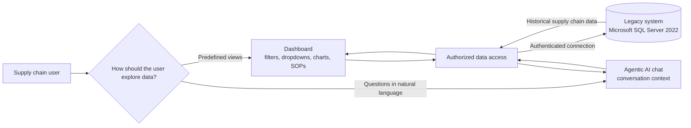

# Problem Statement: Chat with Supply Chain Data

## Background

A logistics supply chain client stores its historical operational data in a legacy system. The data is protected, and access requires credentials supplied by the client. The system runs Microsoft SQL Server 2022 and does not expose an API.

## Problem

Client users need a practical way to explore and understand the supply chain data. They should be able to find useful information without relying on a collection of fixed screens and manually connecting related data themselves.

The existing system creates an access and usability challenge: the data is available in a secured database, but there is no API that a separate application can use, and users need an interface suited to their questions and workflows.

## Possible Approaches

### Dashboard

A dashboard could present data through a user interface with dropdowns, filters, and charts. It could also provide standard operating procedures (SOPs) to guide users through common tasks.

This approach is familiar and can make predefined views easy to use. However, users need to learn which controls and views answer their questions. A dashboard may not support questions outside its predefined options, and it does not inherently connect related data for the user.

### Agentic AI chat interface

A chat interface could let users ask questions in natural language. An AI agent could use the conversation context to help interpret follow-up questions and connect relevant information across the available data.

This approach could make exploration more flexible, but it depends on secure and reliable access to the legacy database. Because the system has no API, the solution will need an approved way to interact with SQL Server directly or through another authorized integration layer.

## Desired Outcome

Provide users with a secure, usable way to ask questions about the client's historical supply chain data and receive answers grounded in that data. The interface should reduce the effort required to find information and relate relevant records.

The choice between a dashboard and an agentic AI chat interface remains an architectural decision to evaluate against user needs, security requirements, and the available database access method.

## Current-System Constraints

- The historical data resides in the client's legacy system.
- The legacy system uses Microsoft SQL Server 2022.
- The system requires authentication, with access credentials provided by the client.
- The system does not provide an API.
- The data is protected, so access and handling must follow the client's security requirements.

## Conceptual View

## Open Questions

- Which users, roles, and workflows should the solution support first?
- What authentication method and network path will the client provide for database access?
- What permissions may the solution use, and are queries restricted to read-only operations?
- Which data entities and relationships are in scope?
- What answer formats, audit records, and response-time expectations are required?
- Should the first release use a dashboard, chat, or a combination of both?
