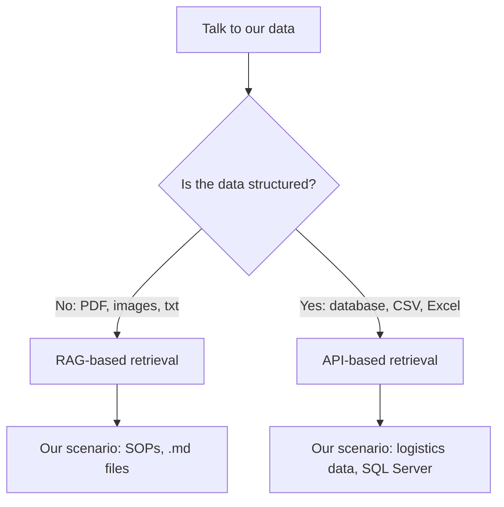
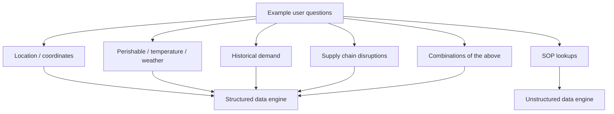
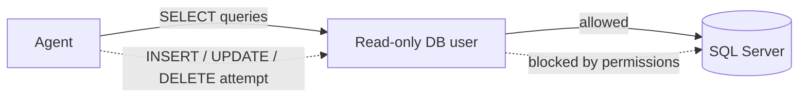
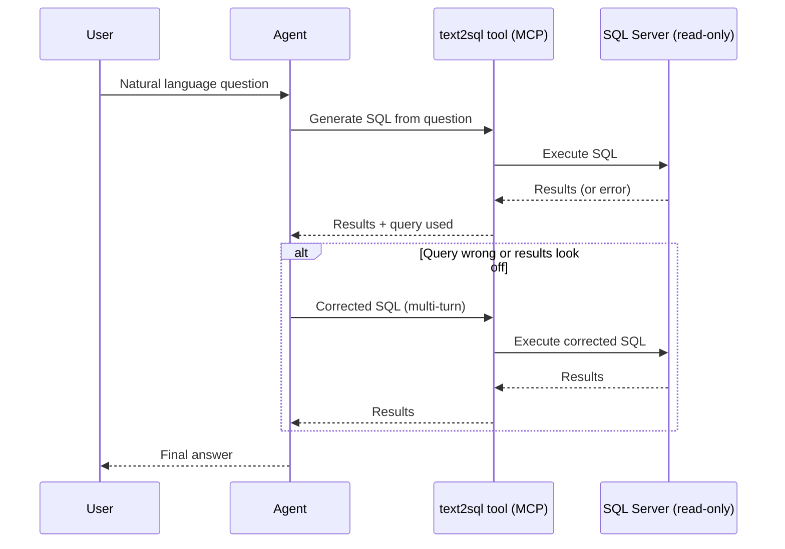
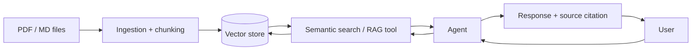

# Designing the Solution

## Is Our Data Structured?

We need to talk to our data. The first question that decision hinges on: is the data structured?

- **No** (PDF, images, txt) → follow a RAG-based retrieval approach for unstructured data.
- **Yes** (database, CSV, Excel) → we cannot use RAG, because we cannot fit ~30k rows into the model's context. Use API-based retrieval for structured data instead.

In our scenario we have **both**: SOPs are unstructured (`.md` files), and the logistics data is structured (SQL Server database).

## Queries the Solution Should Support

- Based on location
- Based on coordinates
- Perishable goods
- Temperature
- Weather conditions
- Combinations of the above
- Historical demand
- Supply chain disruptions
- Queries about SOPs
- etc.

## Security

Ensure data is not inserted or deleted by our agent.

### Solution

We will create a database user with read-only access, limited to `SELECT` queries only. This stops the risk at its source: even if the agent tries to execute an `INSERT`, `UPDATE`, or `DELETE`, it will be blocked by the database's own permissions.

## Data Source

### Structured Data

This data can grow, so we should consider scalable storage solutions and efficient indexing to handle increasing volume.

We will access this data using **MCP (Model Context Protocol)**. This lets us expose tools that interact with the structured data and return an answer, which is then passed to our agent for further processing.

**How many tools?** One to start: **text2sql** — converts natural language queries into SQL queries, letting the agent interact with structured data efficiently.

- **Cons:** if the generated query is not correct, we will not get the desired results.
  - **Mitigation:** a validation and correction mechanism. The agent can see the query results and correct the query if needed — a multi-turn interaction, where the agent has visibility into both the executed query and its results to make informed corrections.
- **Pros:** not limited at all, faster prototyping.

### Unstructured Data

We will use RAG. The user queries the agent, the agent queries semantic search, and RAG is used as a tool for retrieving relevant unstructured data. The agent then processes the retrieved information, uses it as context, and provides the final response to the user.

Open items to work out:
- Chunking strategy (explain this).
- What happens if the source data is modified or deleted?
- The response should include source information, for validation.
- We also need ingestion logic for PDFs, `.md` files, etc.

## Guardrails

We are not adding guardrails, because this is an internal tool. Guardrails are mainly used for external-facing applications, to prevent misuse or unintended actions, or where we handle customer data.