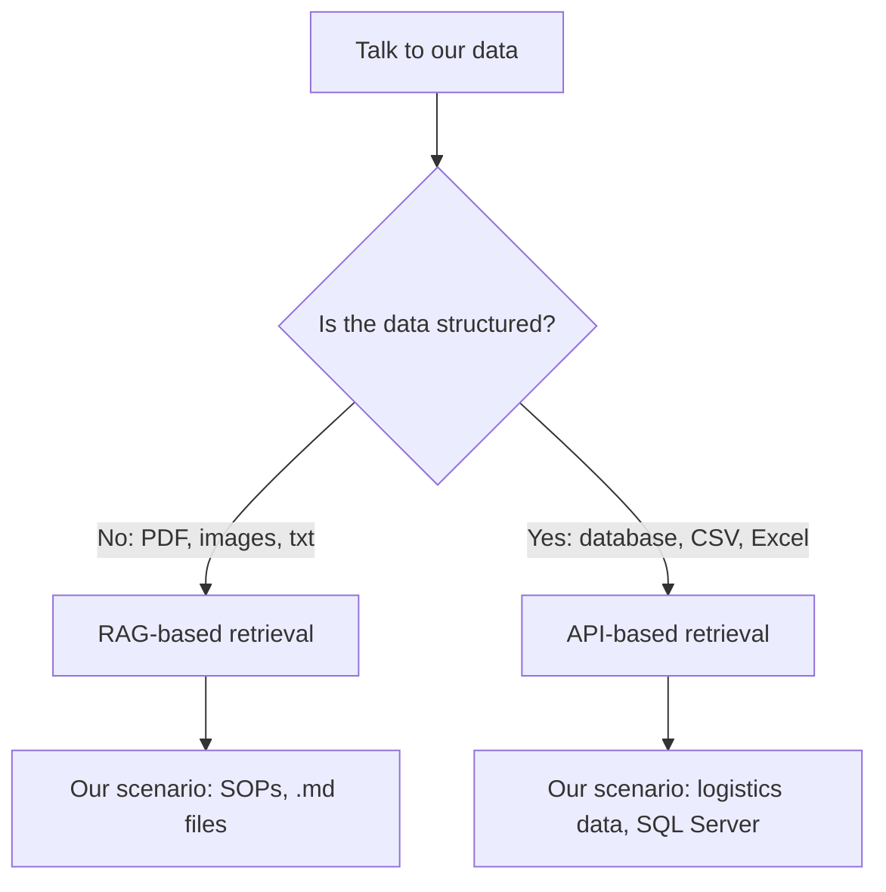
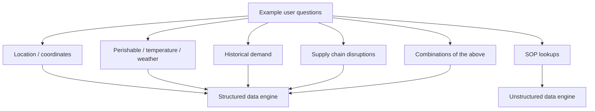
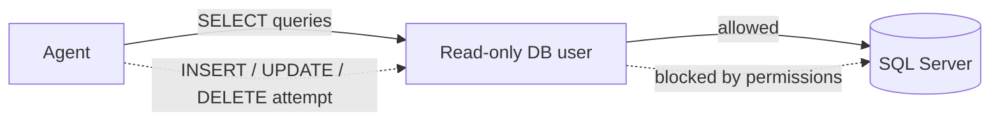
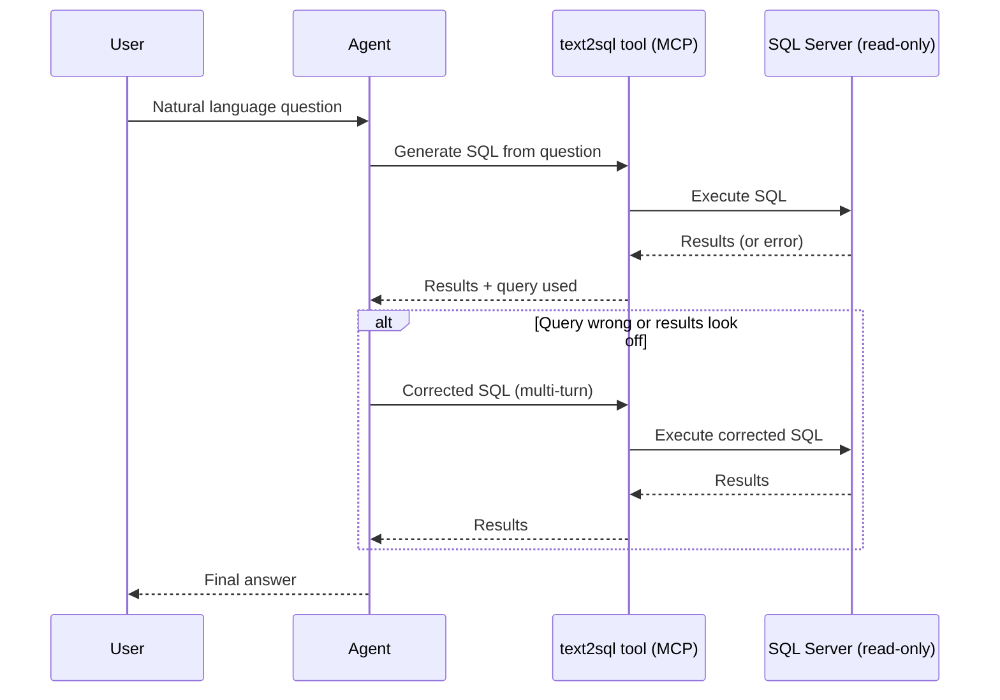
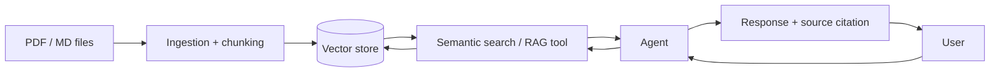

# Designing the Solution

## Is Our Data Structured?

We need to talk to our data. The first question that decision hinges on: is the data structured?

- **No** (PDF, images, txt) → follow a RAG-based retrieval approach for unstructured data.
- **Yes** (database, CSV, Excel) → we cannot use RAG, because we cannot fit ~30k rows into the model's context. Use API-based retrieval for structured data instead.

In our scenario we have **both**: SOPs are unstructured (`.md` files), and the logistics data is structured (SQL Server database).



## Queries the Solution Should Support

- Based on location
- Based on coordinates
- Perishable goods
- Temperature
- Weather conditions
- Combinations of the above
- Historical demand
- Supply chain disruptions
- Queries about SOPs
- etc.



## Security

Ensure data is not inserted or deleted by our agent.

### Solution

We will create a database user with read-only access, limited to `SELECT` queries only. This stops the risk at its source: even if the agent tries to execute an `INSERT`, `UPDATE`, or `DELETE`, it will be blocked by the database's own permissions.



## Data Source

### Structured Data

This data can grow, so we should consider scalable storage solutions and efficient indexing to handle increasing volume.

We will access this data using **MCP (Model Context Protocol)**. This lets us expose tools that interact with the structured data and return an answer, which is then passed to our agent for further processing.

**How many tools?** One to start: **text2sql** — converts natural language queries into SQL queries, letting the agent interact with structured data efficiently.

- **Cons:** if the generated query is not correct, we will not get the desired results.
  - **Mitigation:** a validation and correction mechanism. The agent can see the query results and correct the query if needed — a multi-turn interaction, where the agent has visibility into both the executed query and its results to make informed corrections.
- **Pros:** not limited at all, faster prototyping.



### Unstructured Data

We will use RAG. The user queries the agent, the agent queries semantic search, and RAG is used as a tool for retrieving relevant unstructured data. The agent then processes the retrieved information, uses it as context, and provides the final response to the user.

Open items to work out:

- Chunking strategy (explain this).
- What happens if the source data is modified or deleted?
- The response should include source information, for validation.
- We also need ingestion logic for PDFs, `.md` files, etc.



## Guardrails

We are not adding guardrails, because this is an internal tool. Guardrails are mainly used for external-facing applications, to prevent misuse or unintended actions, or where we handle customer data.

# System Architecture (HLD)

The Cold-Chain Logistics AI-Assistant is a decoupled, three-tier enterprise platform
designed to enable control tower operators to query fleet telemetry, environmental
conditions, and compliance SOPs via a natural language interface.

## Architectural Overview

The system relies on a strictly stateless presentation layer, a state-machine-driven
orchestration engine, and a hardened data access layer.

```mermaid
user -> streamlist frontend -> langrapgh orchestration -> tools -> sql server/vectordb/rest weather api (becuase we need real-time weather data)
```

## Component Responsibilities

- Presentation Tier: Stateless Streamlit application. Manages UI session state
  only; all heavy reasoning is offloaded to the Orchestration Tier.
- Orchestration Engine: A LangGraph ReAct agent. This component is the "brain."
  It manages the execution lifecycle, including intent deconstruction, multi-step
  tool selection, and synthesis of tool outputs into human-readable responses.
- Data & Integration Tier: Decoupled backend systems. The system strictly
  isolates the LLM/Agent from the raw underlying data by utilizing database views
  and read-only role wrappers.

# Low Level Design (LLD)

## Agent Orchestration

The orchestration tier ensures deterministic behavior within a probabilistic framework
by utilizing a state-machine architecture.

### State Management & Execution Loop

The agent utilizes a LangGraph state object to maintain context throughout the
interaction.

1. Ingestion & Parsing: The agent receives natural language input and identifies
   the specific domain (Telemetry vs. SOP vs. Weather).
2. Reasoning Loop: The agent evaluates the current graph state. If the intent is
   ambiguous, it requests clarification. If actionable, it dispatches to the optimal
   tool.
3. Tool Execution: The agent invokes isolated worker functions, ensuring no side
   effects occur outside the tool's specific scope.
4. Synthesis: Raw tool output (e.g., raw JSON, SQL results) is synthesized by the
   LLM into a cited, context-aware answer

### Resiliency & Fallbacks

- Graceful Degradation: If external API calls (e.g., weather) fail, the agent will
  report stale/missing data rather than hallucinating status.
- Self-Correction: If a SQL query returns an error, the agent logs the error and
  attempts a simplified query iteration before escalating.

## Data & Security Model (LLD)

Security is implemented at the physical database layer to mitigate prompt injection
risks.

### Telemetry Security (VW_ACTIVE_FLEET)

The agent interacts solely with a read-only SQL view, VW_ACTIVE_FLEET.

- Fields Exposed: Shipment_ID, Latitude, Longitude, Cargo_Type,
  Current_Temperature.
- Security Principle: By exposing only a flat, view-based schema, we physically
  prevent the agent from executing DROP, UPDATE, or DELETE commands.

### Role-Based Access Control (RBAC)

Database connections are established using the USR_FDE_RO service account. This
account lacks permissions to write, modify schema, or access tables outside the
specified view.

### Immutable Auditing

Every decision cycle is committed to AgentAuditLog (append-only).

- Log Entry: {Timestamp, User_Prompt, Tool_Invoked, Tool_Raw_Output,
  LLM_Decision}.
